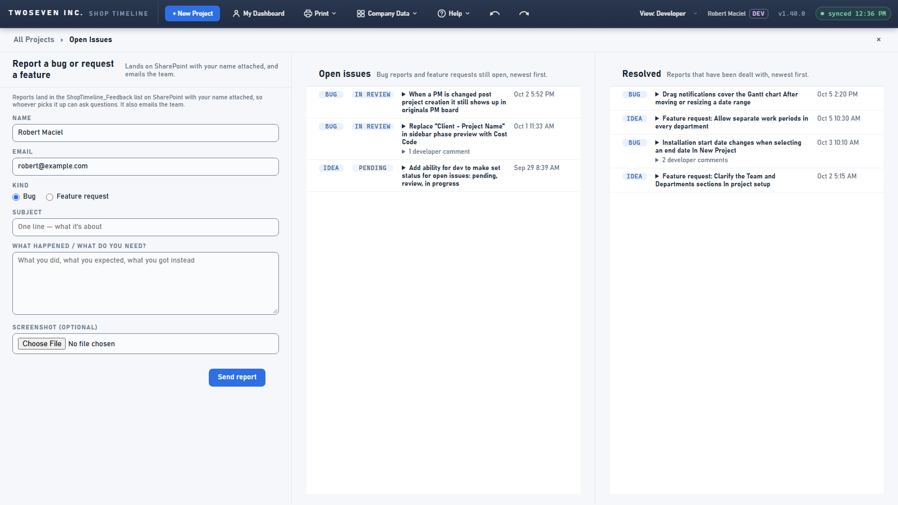
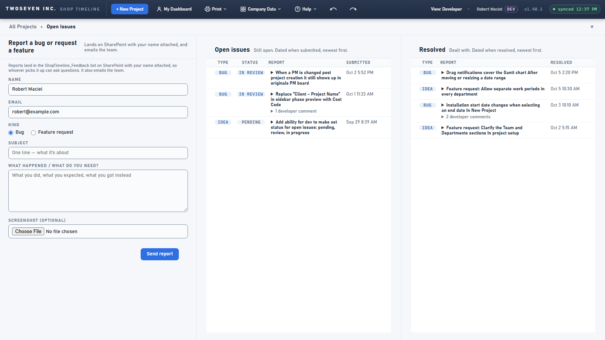

# 2026-10-06 — Open Issues: column labels and dates that say what they are

**Date:** 2026-10-06 · **Version:** 1.40.1 · **Branch:** `fix/issues-column-labels` →
development (PR #102), promoted to main by PR #103 · Record written 2026-10-15 (item 23).

The two lists on the Open Issues page had no headings, and a date could mean submitted or
resolved depending on the list.

## What changed

- **A label row on each list**, pinned while the list scrolls: Open issues reads Type ·
  Status · Report · Submitted; Resolved reads Type · Report · Resolved (no Status — the
  list is the state).
- **Subtitles name the date and the order:** "Dated when submitted, newest first" /
  "Dated when resolved, newest first".
- **Hovering a date shows every date the report has in full:** submitted, resolved (or
  "not recorded", with the last change standing in) and the latest developer comment.
- Visible dates and sort order are unchanged. No SharePoint change.

| Before | After |
|---|---|
|  |  |

Guarded by `test-v1401`.
