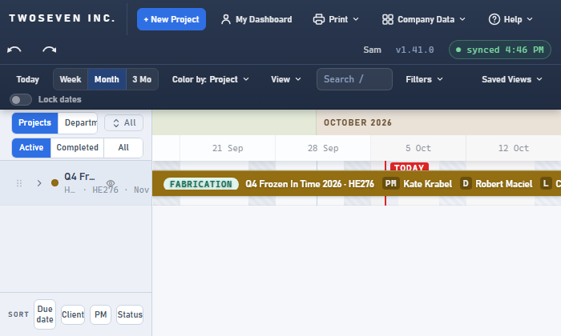
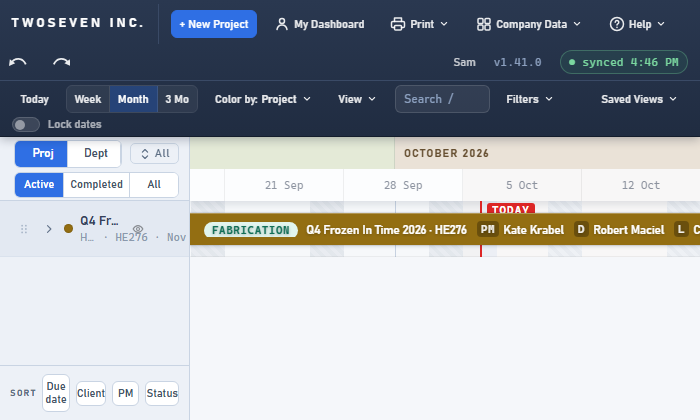

# 2026-10-06 — The Projects / Departments switch fits a narrow sidebar

**Date:** 2026-10-06 · **Version:** 1.41.1 · **Branch:** `fix/sidebar-lens-toggle` →
development (PR #106) · **Commit:** `dc37ee5` · Record written 2026-10-15 (item 23).

Below about 240px of sidebar, the switch above the list read only "Projects":
"Departments" was clipped off.

## What changed

- A CSS container query on the sidebar header swaps the labels for **Proj / Dept** when
  the sidebar is narrow (`data-short` on each button).
- The tooltip and the accessible name keep the full words, so screen readers still hear
  "Projects" / "Departments".

| Before | After |
|---|---|
|  |  |

Guarded by `test-v1411`.
