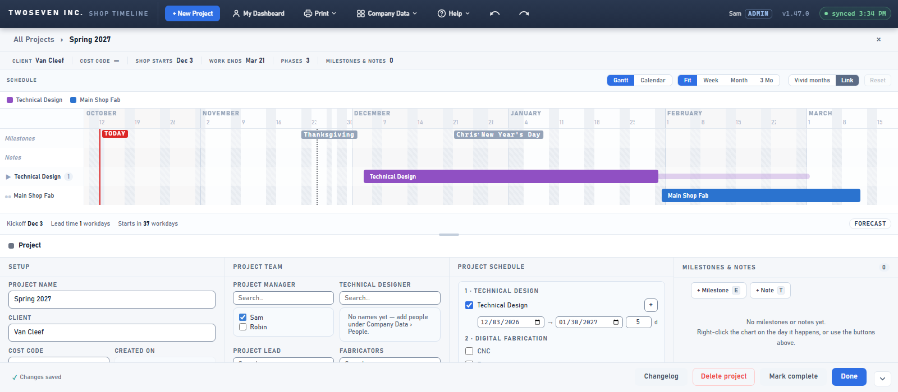

# The overall-span track is named — v1.47.1 (2026-10-12)

**TODO item 8** (brief §7 Rollup, §8.2, §14). PR #135.

## What changed and why

On a project's Gantt, each department row draws a faint track (`.npv-env`) behind its bars.
It runs from the department's first start to its last finish, so when a department runs more
than once (a subtask, a second range) the track also covers the gap between them. The brief
flagged that this can read as continuous work.

The owner's batch plan said to label it rather than drop it. The legend now carries an
entry, **Overall span (gaps aren't work)**. Its swatch has the track's shape and colour, and
its tooltip reads: "The faint track behind a department's bars runs from its first start to
its last finish. Gaps inside it are not work."

The entry shows only where a track can actually be seen:

- on the Gantt only (the calendar has no track);
- only when a subtask reaches past its department's main bar.

Ranges (v1.32.0) never get a track, and a subtask inside the main bar's dates leaves the
track hidden behind the bar. In both cases there's nothing to explain.

The track itself can't carry its own tooltip: it ignores the pointer so it never gets in
the way of dragging the bars.

| Before | After |
|---|---|
|  |  |

## Follow-up

The item's fact-check named two whole-project numbers that also span gaps: the Meeting
Sheet progress % and the project page's "Lead time". Whether they change is the owner's
call, now **item 59**. Double-booking checks already use the actual blocks.

Tests: `tests/test-v1471.js`.
