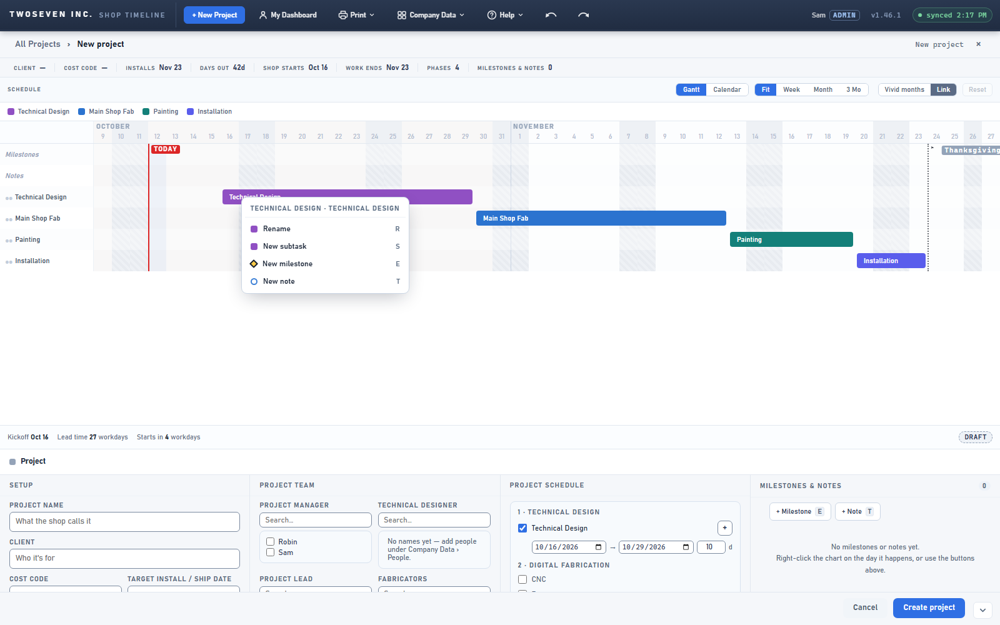
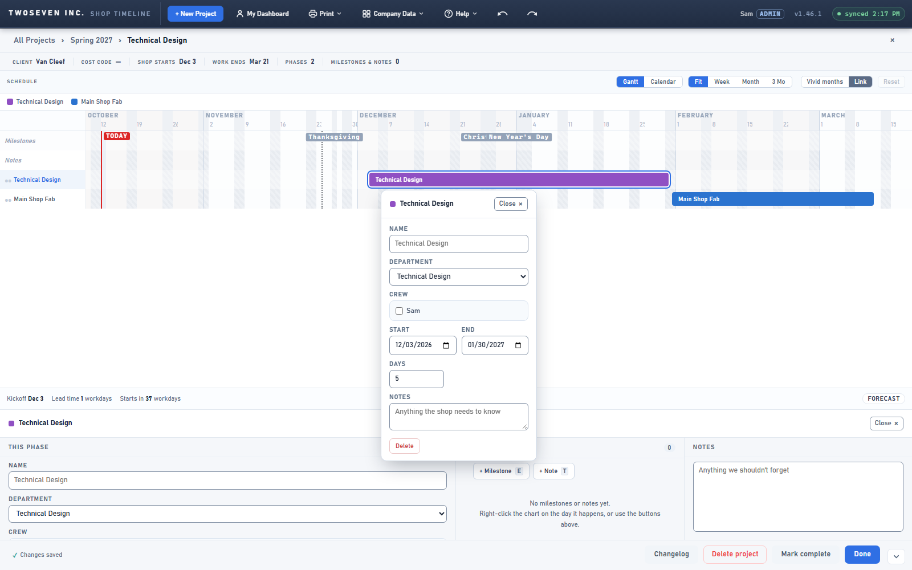
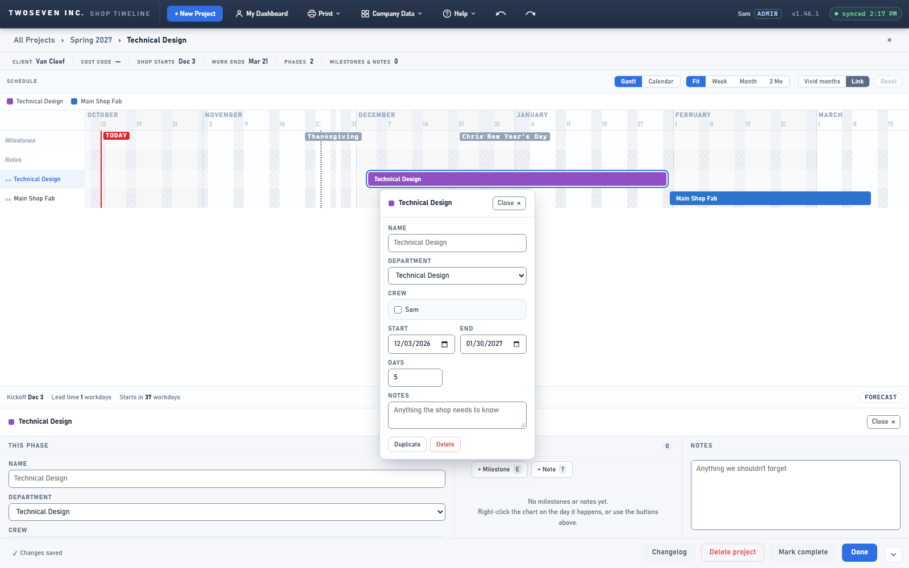

# Repeat work is easier to find — v1.47.0 (2026-10-12)

**TODO item 7** (brief §1, §7 "Repeat work" and "New Project layout"). PR #134.

## What changed and why

Each department block has always been its own record, and Duplicate and New subtask worked
even on a draft. But Duplicate lived only in the bottom inspector, so people didn't find it.

- **Duplicate on the bar.** A project-page bar's right-click menu now offers Duplicate,
  right after Rename, on saved projects and drafts. Duplicating makes a new bar, so it is an
  *add*, and the menu's add-only rule (Design Language, N11) still holds. The bar's edit
  popover has a Duplicate button beside Delete. View-only users never see it.
- **The ⋯ cue.** Project-page bars show the timeline's faint ⋯ at their right end on hover,
  hinting that a right-click menu is there.
- **New Project's divider.** The bar between the chart and the form shows its drag grip all
  the time, not only on hover. The draft's footer counts the required fields ("1 of 3
  required") and names each missing one as a link. A click opens the project form (even when
  a bar is selected or the panel is collapsed) and puts the cursor in that field. With all
  three filled it reads "Ready to create". Create itself still checks and names what's
  missing, as before.

| Before | After |
|---|---|
|  |  |
|  |  |

## Limits

- "Section progress" in the item is read as the required-field count. Per-section
  (Setup / Team / Schedule) progress was not built.
- The main timeline's bars still have no right-click menu. The ⋯ there is the old hint;
  item 7 didn't ask for one.
- Tests: `tests/test-v1470.js`. Three older suites (test49, test50, test53) now expect
  Duplicate on the bar menu.
