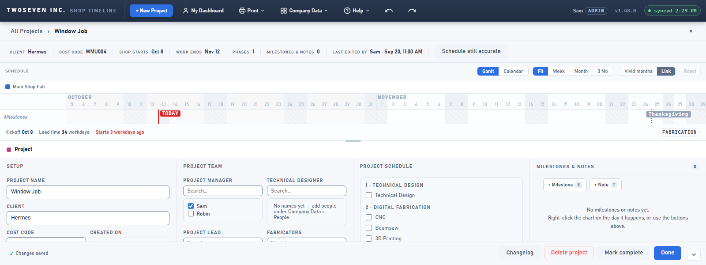
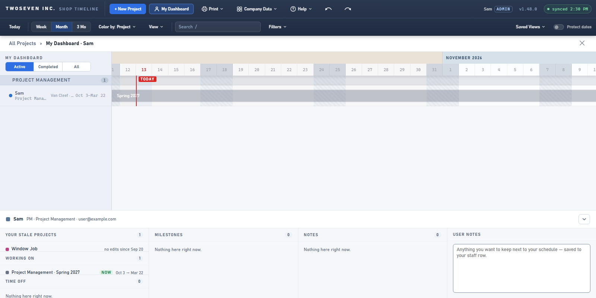
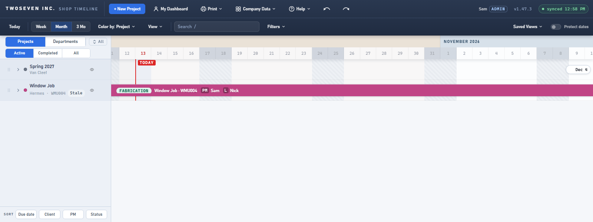
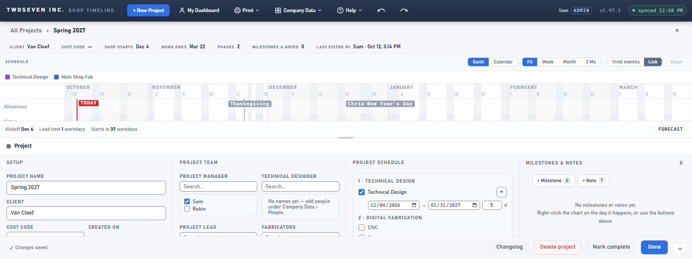

# Last edit shown, stale projects flagged — v1.48.0 (2026-10-13)

**TODO item 6** (brief §5.1, §7 Reliability, §9 P1 "stale-data warnings"). PR #142.

## What changed and why

Graph already records who last changed each row and when. The app showed it only in hover
cards and the admin change log, so a schedule nobody had touched for weeks looked as current
as one edited this morning.

- **The project page header** gets a cell: **Last edited by Sam · Oct 12, 2:14 PM**.
- **The Meeting Sheet** prints the same line under each project's name.
- **The sidebar** gets a grey **Stale** tag (tooltip "No edits in 14 days") on any project
  with no edit in 14 days. It's grey on purpose: a nudge, not an alarm like LATE. A completed
  project is never stale, and nor is one On Hold (idle on purpose).
- **"Last edited"** is the newest change to the project *or any of its phases and notes*, so
  rescheduling a phase counts, not just editing Setup. Milestones carry no stamp of their own.
- **The 14 days** is an App setting (Help ▸ App settings ▸ Projects ▸ "Stale after N days",
  Config key `stale.days`), so it changes without a release. Owner, 2026-10-13: default 14;
  the Project Director can still pick the number.

The wording was agreed with the owner before building (item 8's lesson), and the legend got no
entry.

## The call to action (added before merge, owner 2026-10-13)

The owner asked: what is someone supposed to *do* with a stale project, and where is the
prompt? The first build had no answer. The chip was passive, and the only way to clear it was
a fake edit. Three additions fix that:

- **The action, "Schedule still accurate":** a button on a stale project's header, for
  people who can edit project setup. It writes two new Projects columns, `confirmedAt` and
  `confirmedBy`, and nothing else: no undo entry, no change-log row. The tag clears, and the
  header reads "Last edited by Sam · Sep 20, 11:00 AM · confirmed Oct 13 by Sam".
  SharePoint stamps that write as the row's last change too, so the app ignores the project
  row's stamp when it is the confirmation. "Last edited" stays the real last edit.
- **The prompt, on My Dashboard:** a PM's own dashboard leads its first column with "Your
  stale projects", one click each to the project. It is hidden when there are none.
- **The chip's tooltip** says what to do: "No edits in 14 days. Open it to update the
  schedule, or confirm it's still accurate."
- **The owner added the columns on 2026-10-13.** On a site without them, the button explains that they're missing.

| The action | The prompt |
|---|---|
|  |  |

| Before | After |
|---|---|
|  |  |
|  |  |

Top row: Window Job, untouched since Sep 20, now carries "Stale". Bottom row: the project
header's new "Last edited by" cell.

## Limits

- A change made outside the app (on the SharePoint list) also counts, since it's the same Graph stamp.
- A new App-settings value reaches each user on their next reload, like the other settings.

Tests: `tests/test-v1480.js`. `test-v1260` now reads only the due-date tag beside the Stale chip.
