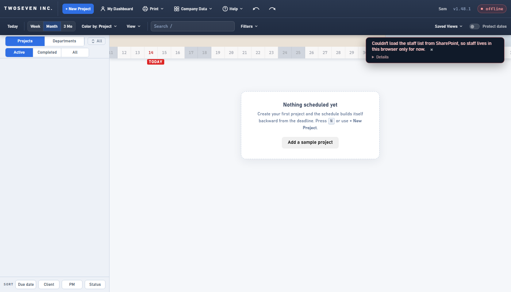
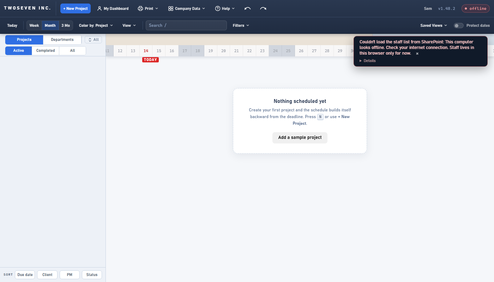

# The storage seam, finished — v1.48.2 (2026-10-14)

**TODO item 48** (`docs/Architecture-Review-Storage.md` idea 1; D4, D15). Eight PRs:
#130, #131, #137, #139, #141, #147, #148, and PR 8 (#149).

## What changed and why

The app used to talk to SharePoint from 37 places in 16 functions, each one building its own
Graph URL and token. Now one object, `store`, does all of it:

- `store.list / create / update / remove / columns` for every list (PRs 1–6);
- `store.signIn` and `store.who()` for who is signed in (PR 7);
- `store.explain(err)` for why a call failed (PR 8).

The Team-members read, the feedback mail and the screenshot upload go through the same
request helper (`gfetch`). An optional silent `scopes` argument keeps their "no consent →
degrade quietly" behaviour.

**Why it mattered:** the code is simpler. Whatever D15 decides, a new backend now means
replacing one object, not hunting through the file. PRs 1–7 changed nothing anyone could
see: the same requests went out byte for byte, and no test was edited.

## The one visible change (v1.48.2, PR 8)

Error messages used to be hand-written one by one, and many were guesses ("check it lives on
the TWOSEVENINC site"). Now every failure reads **what failed: why. What to do next.** The
"why" comes from the error itself:

| Error | Why |
|---|---|
| No network | This computer looks offline. Check your internet connection. |
| 401 / 403 | Your Microsoft account doesn't have access to that list. |
| 404 | The list isn't on the TWOSEVENINC site. |
| 400 | A column is missing from the list. Click Details below to see which one. |
| 429 / 5xx | SharePoint is busy right now. |
| Anything else | SharePoint returned an error. Click Details below for the full message. |

A 404 for a row someone else already deleted, and a 400 for a bad value (not a missing
column), get the "anything else" sentence, so neither sends anyone hunting for a schema
problem. The owner approved the wording before it was built (2026-10-14). The changelog and feedback
panels show the same sentence, without the "Click Details" part (they have no Details link).

The same offline start-up, before and after:

## Left out, on purpose

- **`store.available(kind)`** in place of the five `*_OK` flags: a rename with nothing to see,
  and four test files to edit. It's in the §7.4 ledger, gated on D15 choosing a non-SharePoint
  store.
- **One page size for every list:** it changes request URLs, so it waited until the
  sequence closed. It's item 68.
