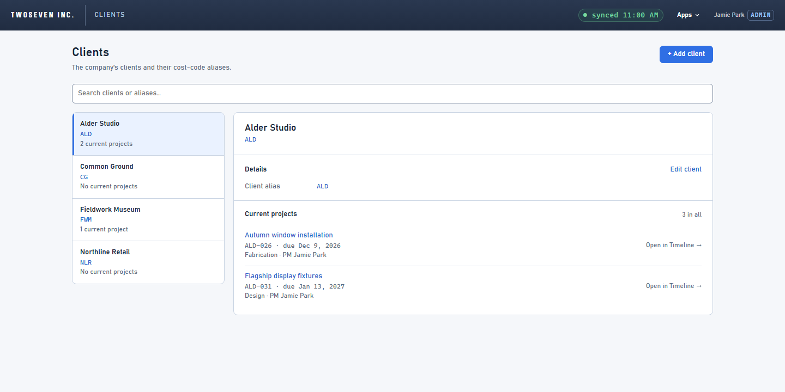
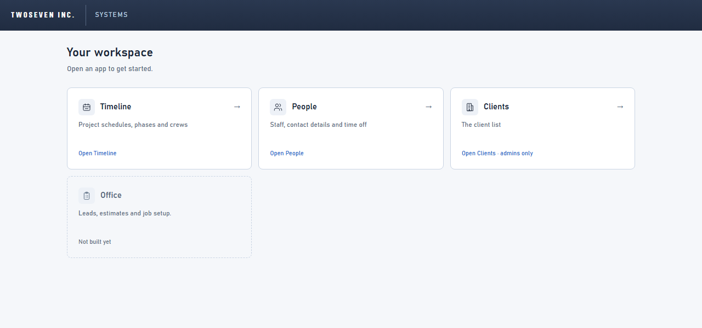
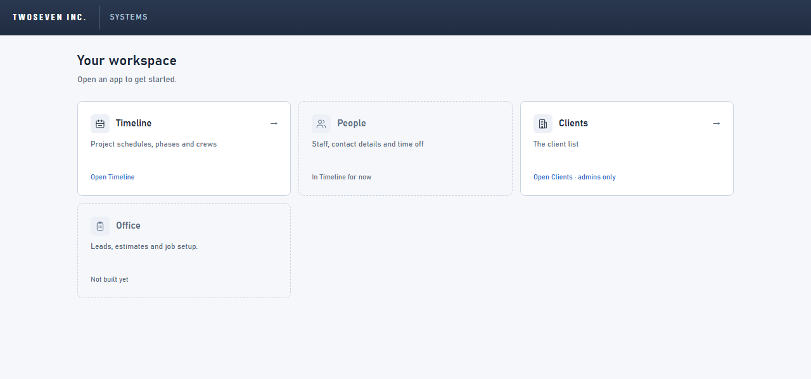
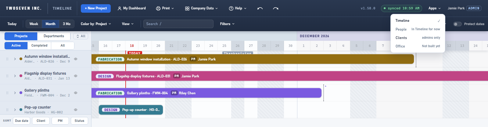
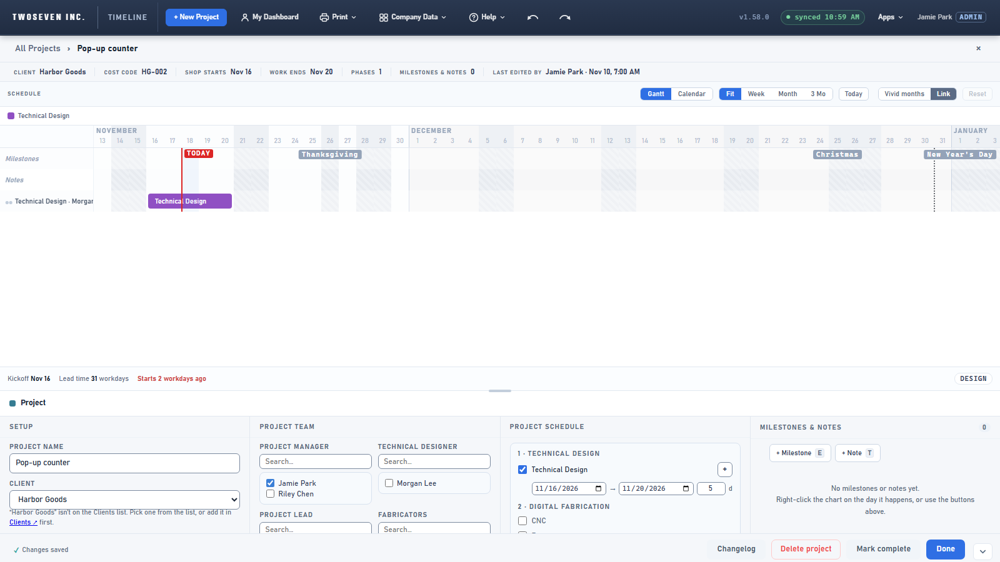

# Clients, its own app — v1.58.0 (2026-11-18)

**TODO items 86 and 85 (b)**, the last piece of launch 1. PR #208; the deploy lists went to
`main` first in PR #207. The owner gave the go, picked the wording and approved the mock on
2026-11-18.

## What changed and why

Launch 1 puts the Systems page in front of the shop, and the owner ruled that it ships only
when its cards lead somewhere new. Clients is the first app after Timeline: the client list
moves out of Timeline into `clients/`, a page of its own built to the owner's Clients
wireframe.

- **The Clients app** (`/clients/`):
  - It has the shared header (TWOSEVEN INC., CLIENTS, the sync pill, Apps, who's signed in).
  - Under it: the title and its line, "The company's clients and their cost-code aliases.",
    and **+ Add client**.
  - A search box ("Search clients or aliases…"), the list and the selected client's record.
- **Each client in the list** shows its alias and how many current projects it has.
- **A client's record** shows:
  - its alias, with **Edit client**;
  - its current projects, soonest due first: code and due date, status and PM, and a link
    that opens the project in Timeline. "N in all" counts the finished ones too.
- **The rules are Timeline's.**
  - A renamed client still finds its projects through the stable IDs (item 28).
  - A project's status and due date use the same rule Timeline uses.
  - Names are trimmed, the alias is uppercased, and duplicate names are refused.
  - Removing a client asks first, with the project count.
  - Saves are instant on screen, and a failed save offers "click to retry" on the pill.
- **Admins only, as before.** Anyone else sees "Clients is for admins." and a button back to
  Timeline.
- **No left menu** while Clients has only one section (owner's pick). Contacts, Reports and
  Settings from the wireframe wait until they exist.

**In Timeline:**
- Company Data no longer lists Clients.
- An old `#/clients` link goes on to the Clients app.
- When a project's client isn't on the list, the note links to **Clients ↗** (a new tab).
- Coming back to the Timeline tab re-reads the client list, so a client just added is in
  the dropdown straight away. The 90-second refresh reads it too, so a renamed client
  reaches the schedule.

**On the Systems page and in the Apps menu:**
- The Clients card opens the new app.
- People shows greyed, "In Timeline for now", until it gets its own app (launch 2).

**Item 85 (b), the shared part.** The update check, the Config reader, the admin rule, and the
data rules the Clients app reads by moved word for word into `common/common.js`. Those data
rules are dates, the departments, a project's status and due date, and the project and phase
readers. Each app supplies only its own "don't disturb" rule. The viewer grants stay in
Timeline: they open Timeline's own doors.

No SharePoint list or column changed. The app reads Projects, phases, Staff and Config and
writes only the Clients list. **The owner adds the `/clients/` and `/preview/clients/`
redirect URIs in Entra before this merges** (`docs/SETUP.md`).

## Screenshots

| | |
|---|---|
| The Clients app |  |
| Systems page, before |  |
| Systems page, after |  |
| Timeline's Apps menu, before |  |
| Timeline's Apps menu, after |  |
| A project whose client isn't on the list |  |

All fictional data.

## Known limits and follow-ups

- **No Help menu in the Clients app yet.** Release notes, "Report a bug or idea" and the tour
  are in Timeline's Help. They move into the shared header once the People app makes a
  second app that needs them (TODO §7).
- **A rename reaches Timeline's schedule on its next refresh** (within 3 minutes, every
  other 90-second tick), or at once on a reload. Coming back to the tab updates the
  dropdown, not the bars.
- The Clients app reads every project and phase to count current projects. It's the same
  read Timeline makes on load, and it repeats only when the tab comes back into view.

## Checks

- `tests/test-v1580.js` (61 checks) covers:
  - the page and its wording;
  - the list, search and the empty lines;
  - the record (soonest due first, status and due date as Timeline works them out, a
    renamed client found by its stable ID);
  - editing: trim, uppercase, duplicates, PATCH, the remove question and DELETE;
  - a failed save, retry and the leave-page warning;
  - access: the ADMIN chip, and the non-admin page;
  - that the app writes only the Clients list;
  - the update check's busy rule;
  - Timeline's side: no Clients page, the old link, the note's link, and a just-added
    client in the dropdown on a saved project and on the New Project draft.
- `/code-review` (high) found 7 items, and 5 were fixed:
  - With the projects unreadable, every client would have read "No current projects". Now
    no count shows, and the record says it couldn't read the projects.
  - With the staff list unreadable, everyone could have edited. Timeline's cached roster now
    decides, as it does in Timeline.
  - "Edit client" got a 24px target.
  - The ADMIN chip now comes from the shared stylesheet.
  - The list refresh skips non-admins.

  The rename timing and the Help menu, above, were left as known limits.
- Old assertions moved to where the behaviour now lives: `test69` and `test-v170` (manage
  the list in the app), `test-v180`, `test-v1181`, `test-v1263`, `test-v1441`, `test-v1483`,
  `test-v1520`, `test-v1530`, `test88`, `test-v1560`, `test-v1561`, `test-v1570`. The
  deploy check covers the new page.
