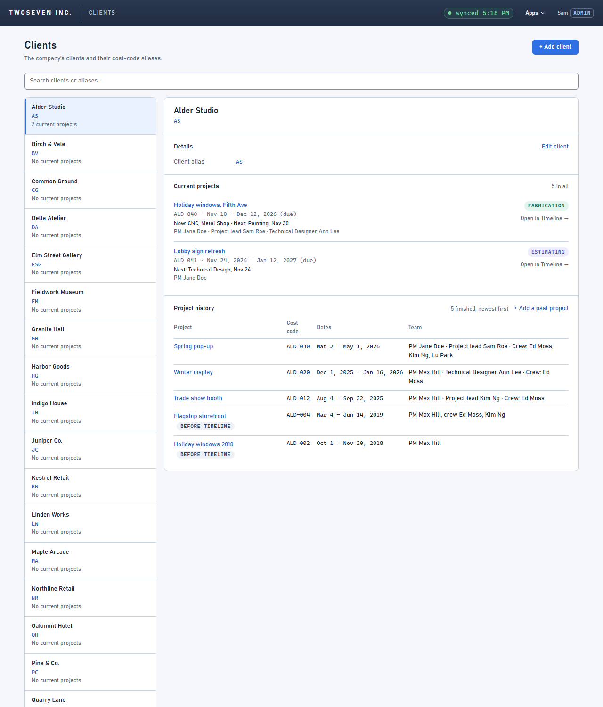
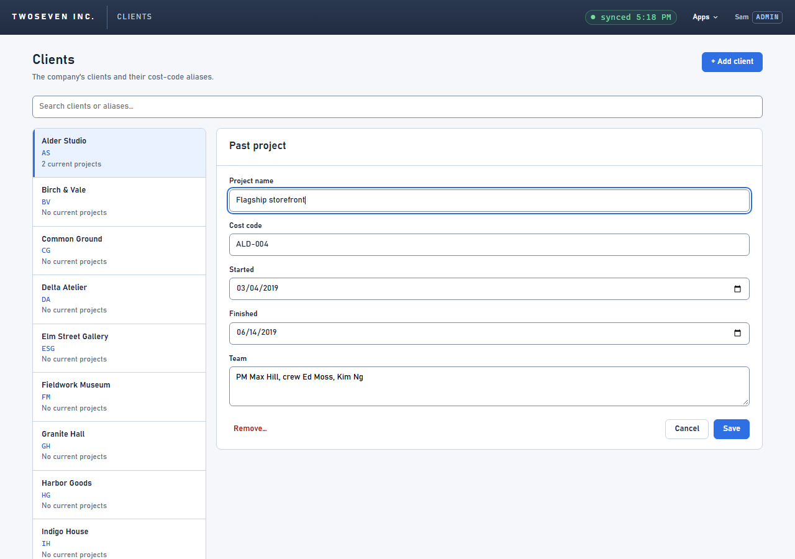

# Clients: projects from before Timeline in a client's history — v1.60.0

**Date:** 2026-11-18 · **Version:** v1.60.0 · **Item:** 93 (from the owner's design review, item 90)
· **PR:** see `docs/TODO-Done.md`, item 93

## What changed

The owner: *"Management will add pre-timeline projects if necessary"*. They don't go in
Timeline. On where: "Yes, in Clients". On the wording: "Wording OK". The owner created the
list the same day.

- **"+ Add a past project"** sits in a client's Project history header. Its form, "Past
  project", takes the project's name, cost code, start and finish dates, and team (free text).
- **In the history,** past projects sit beside Timeline's finished projects by finish date,
  tagged "Before Timeline". A click opens one to change or remove it.
- **Saving works like the client list:** the screen changes straight away. A failed save stays
  on screen and the sync pill retries it.

The Clients app owns the new list, `ShopTimeline_PastProjects` (`Title`, `clientId`,
`jobCode`, `startDate`, `endDate`, `team`; see "Data and schema" in `docs/Decisions.md`). A
past project belongs to its client by the client's SharePoint ID, so renaming a client keeps
its history. Without the list, Clients shows no add button and the history is as before.

## Screenshots

| The history | The form |
|---|---|
|  |  |

Fictional seed data, stubbed sign-in.

## Limits and follow-ups

- Removing a client leaves its past projects in the list, unseen. Adding the client again
  doesn't bring them back, because a new client has a new ID.
- Dates are stored at noon UTC, so a date-only column keeps the same day in any US time zone.
