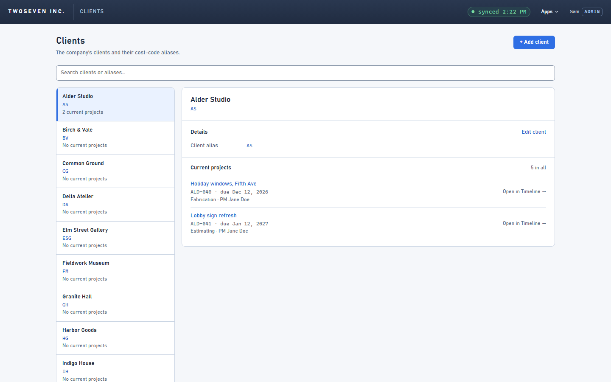
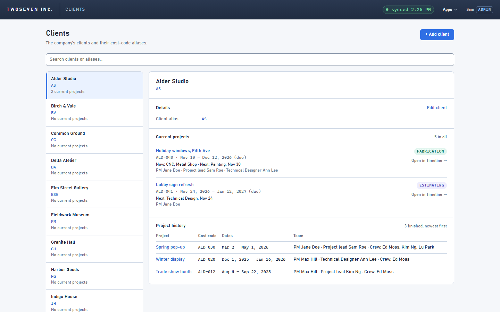
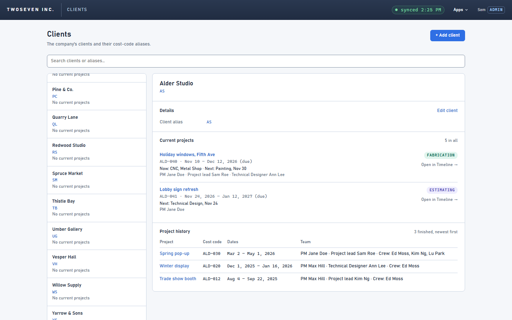

# Clients: a list that scrolls on its own, and a fuller client record — v1.59.0

**Date:** 2026-11-18 · **Version:** v1.59.0 · **Item:** 92 (from the owner's design review, item 90)
· **PR:** see `docs/TODO-Done.md`, item 92

## What changed

The owner's first notes on the Clients app: *"This menu should scroll independently. Client
info should have current projects with at-a-glance info for each, project history (with
names, cost codes and dates, team assignments)."*

- **The client list scrolls on its own.** It stays beside the record while the page scrolls,
  and scrolls inside its own box. On a phone it sits above the record in a short box.
- **Each current project, at a glance:** its cost code, its start and due dates, the phases
  running today and the next one to start, its status (as Timeline's coloured pill), and its
  PM, lead and designer. It still opens in Timeline.
- **Project history:** every finished project, newest first, in a table: the name (opens in
  Timeline), the cost code, the dates and the whole team. The team is the PM, lead and
  designer, then the crew read from the project's fabricators and from who's assigned to its
  phases.

Everything is read from Timeline's projects and phases. Clients still writes only its own
client list.

## Screenshots

| Before | After |
|---|---|
|  |  |

The list scrolled on its own, the record unmoved:

## Limits and follow-ups

- **Projects from before Timeline** don't appear yet. The owner wants management to enter
  them somewhere other than Timeline; the proposal (in the Clients app, in a new list) waits
  on the owner's OK and the list being created. Item 93.
- A project's dates come from its phases. A finished project with no phases shows a dash.
