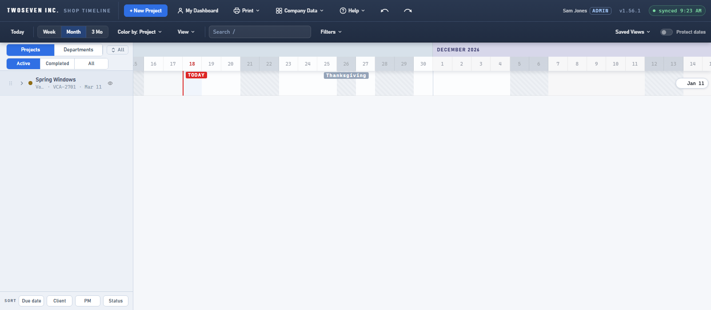
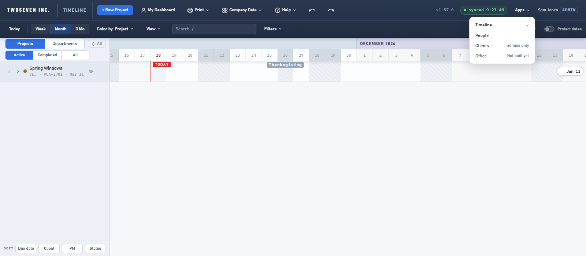
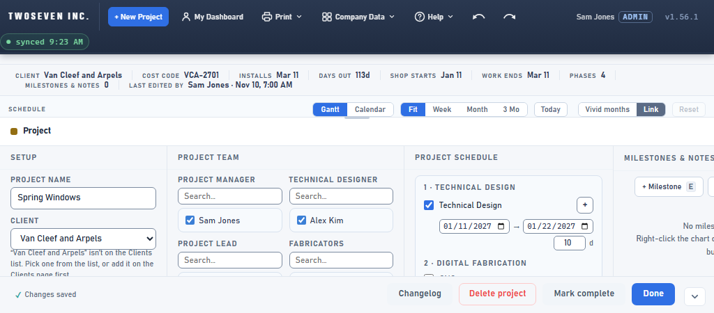
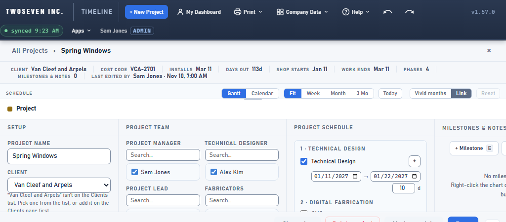

# The shell: the Systems header and the Apps menu — v1.57.0 (2026-11-18)

**TODO item 52, step 4** (style guide §13 step 4), part of launch 1. PR #206.

## What changed and why

Launch 1 puts the Systems page and a second product (the Clients app, item 86) in front
of the shop. Moving between them needs one header that looks and works the same in every
product. The owner picked the details on 2026-11-18:

- **TWOSEVEN INC. opens the Systems page.** It was Timeline's home button.
- **The name beside it reads "Timeline"** (was "Shop Timeline") and is now the home button:
  one click goes back to the full timeline from any page, as the wordmark used to.
- **Timeline's own buttons stay in the header row** (+ New Project, My Dashboard, Print,
  Company Data, Help, undo and redo). The row is 56px tall now, as the style guide asks.
- **An Apps menu at the right** lists the four Systems products in the Systems page's
  order: Timeline (ticked, you're in it), People, Clients ("admins only") and Office
  ("Not built yet", greyed). Non-admins don't see Clients, the same as Company Data ▸
  Clients. People and Clients still open Timeline's own pages until their apps exist.
- **Who's signed in** moved to the end of the header, where the wireframes put the account.
- **The Help menu's version line** reads "Timeline · v1.57.0". Printed pages keep "Shop
  Timeline": the owner changed the header only.

Under the hood the header pieces live in `common/`, so the Clients app gets the same header:
`common.css` has the bar, the wordmark (with its font) and the menu rows; `common.js` has
the list of products (`SYSTEMS_APPS`) and `appsMenu()`, which fills a product's menu. The
Systems page loads `common.css` and no longer keeps its own copy of the colour tokens (a
code-review follow-up from item 85). It looks exactly the same.

**A fix that came with it:** the project page and the Company Data pages were pinned 50px
below the top of the window. In a narrow window the toolbar wraps to two lines, and the
page's top line (All Projects › the project's name) hid under it. Every page now sits under
the toolbar's measured height, however it wraps.

## Screenshots

| Before (v1.56.1) | After (v1.57.0, Apps open) |
|---|---|
|  |  |
|  |  |

The bottom row is the project page in a 1024px window: before, the toolbar covers the page's
top line; after, the page starts below it.

## Known limits and follow-ups

- **Item 86** points the menu's Clients at the Clients app and greys People, together with
  the Systems page's cards. `test-v1570` fails if the list and the cards disagree.
- **The menu is a plain list of links**, like Timeline's other toolbar menus: Tab moves
  through it and Escape closes it, but arrow keys don't move between rows, and the button
  doesn't announce open or closed (`aria-expanded`).
- **Focus outlines on the dark header** use the same blue as everywhere else, which is
  2.5:1 against the header (WCAG asks 3:1). That's true of every toolbar button today, not
  new here. Both go to style §13 step 3 (the chrome restyle); the TODO's §7 ledger has them.
- The wireframes' avatar (initials in a circle) and role badge wait for the account menu;
  the header shows the name and the ADMIN/DEV chip as before.

## Checks

- `tests/test-v1570.js` (44 checks): the wordmark link and its accessible name; "Timeline"
  goes home from People and from the New Project draft; the Apps menu's rows, links,
  greying and closing; a non-admin doesn't see Clients; the list matches the Systems page's
  cards; the header row is 56px and the name sits last; the pages use the measured height;
  the shared pieces live in `common/` and `npm run notes` stamps the Systems page's tag; both
  project pages (saved and draft) show the header and open the menu.
- Old assertions updated for the intended changes: `test-v1100` (the home button, the
  name's place), `test-v171` and `test-v172` (the wordmark's class and element),
  `test-v1560` (the Systems page's header classes and font).
- `/code-review` (high): the menu's label was on a plain `div`, which screen readers
  ignore; it's a `nav` now. The two gaps above were deferred; the always-shown name making
  the header wrap sooner and the Systems page needing `common.css` were accepted.
- Accessibility (Design-Language §9): the product name on the header is 6.9:1; menu text and
  notes 5.5:1 or better; every new control is a link or button, reachable by keyboard; the
  greyed row says "Not built yet" in words; text is 11px or larger; targets are 24px or
  taller.
