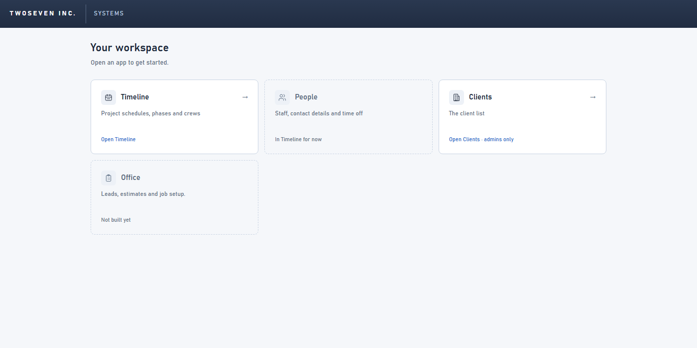
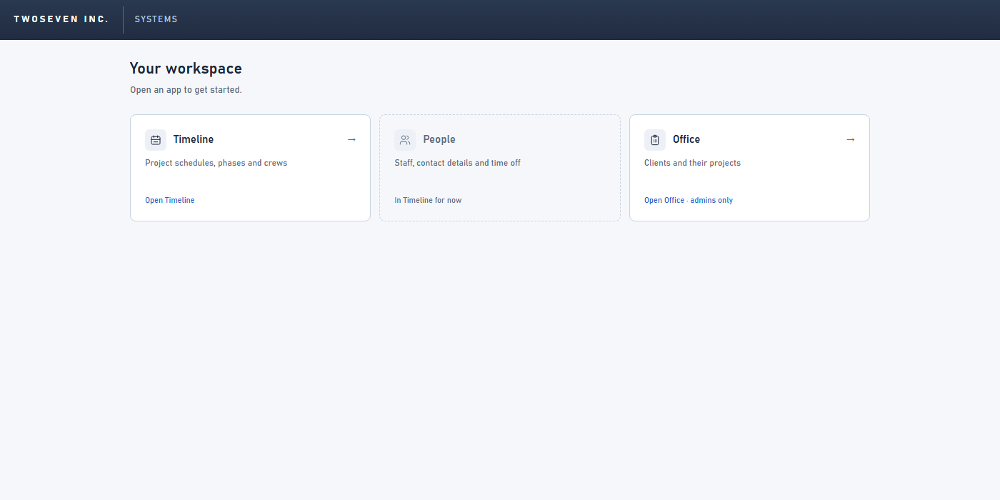
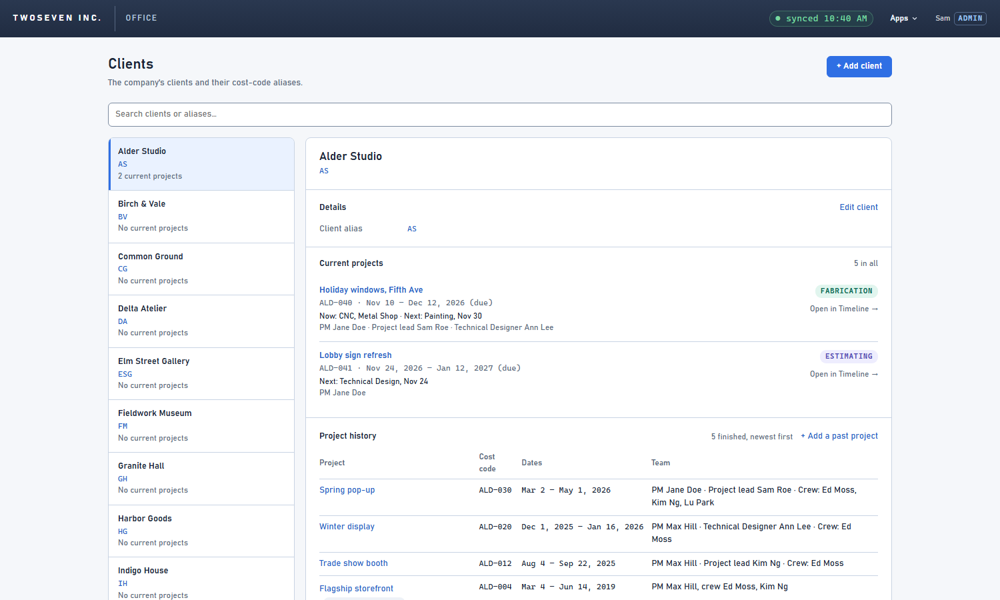

# Clients becomes Office — v1.61.0

**Date:** 2026-11-19 · **Version:** v1.61.0 · **Item:** 94 (from the owner's design review,
item 90) · **PR:** see `docs/TODO-Done.md`, item 94

## What changed

The owner, on where project setup and closeout belong: *"let's use what we have now as
Office, since it is a more comprehensive name. Clients is more narrow and fits inside
office."* Systems now has three products: People, Office and Timeline. The ruling is in
`docs/Decisions.md` ("What we're building"). On the plan: "Go ahead". On the wording:
"Wording OK".

- **The app is Office, at `office/`.** Its header, browser tab, sign-in prompt and
  admins-only note say Office. The page itself is still the client list, headed "Clients".
- **The Systems page** has three cards: Timeline, People and Office ("Clients and their
  projects", "Open Office · admins only"). The Clients card is gone.
- **The Apps menu** lists Timeline, People and Office; non-admins don't see Office.
- **Old links still work.** `clients/` is now a page that forwards to `office/`, keeping the
  rest of the address. Timeline's old `#/clients` link and its "add it in Office ↗" note go
  to `office/` directly.
- **No data changed.** The lists keep their names (`ShopTimeline_Clients`,
  `ShopTimeline_PastProjects`).

## Before the merge

The owner adds the `/office/` and `/preview/office/` sign-in (redirect) addresses to the
Entra app. Without them, signing in on the new address fails.

## Screenshots

| Systems page, before | Systems page, after |
|---|---|
|  |  |

Fictional seed data, stubbed sign-in.

## Left for later

- The forwarding page and the `/clients/` sign-in addresses go with the tidy-up after the
  launch (item 91).
- Setup and closeout arrive in Office with items 45, 44, 42, 43 and 11, on the client's
  record. Past-project details and dropping the "Before Timeline" tag are item 95.
