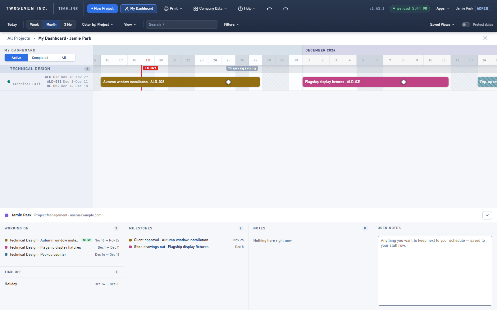

# v1.62.2 — My Dashboard's panel, restyled to match the project inspector

**Date:** 2026-11-19 · **Item:** 52, step 3 (the style track), second surface · **App:** v1.62.2 (preview)

## What changed
My Dashboard's bottom panel (the person's header, then Working On / Time Off, Milestones,
Notes and User Notes) now has the project inspector's look from v1.62.1:

- **Headings** read as written, 13px semibold, not small capitals. Three were reworded to
  Title Case, per the owner's ruling (OK 2026-11-19): **Working On**, **Time Off**, **Your
  Stale Projects**.
- **Header:** the person's name is 14px semibold, and the role and email line under it is 12px.
- **Rows** are 13px and at least 28px tall. Dates stay in plain type at 12px with aligned
  numbers. A monospaced version was tried in the mock, but it cut project names short.
- **The NOW tag** uses the standard success colours and small-tag corners.
- **User Notes** is the inspector's notes box: 13px text and the 2px blue focus ring, instead
  of its own faint glow.
- **The thought popover's fields** (when that feature is on) get a visible edge and 32px height.

The column-heading rule is now one shared rule for both panels, so the inspector's own copy
of it is gone.

## Evidence
Same fictional seed, before and after, 1600×1000:

| Before | After |
|---|---|
|  |  |

Tests: `tests/test-v1622.js` covers the recipes, the headings and rows as rendered, and the
NOW tag. `test-v1621` now reads the shared heading rule. Five older dashboard suites match
the headings without regard to case.

## Accessibility (Design-Language §9)
- Text contrast: rows in `--ts-text`, dates and empty states in `--ts-muted`, NOW in the
  success pair. All are ≥ 4.5:1 (`test-contrast` green).
- Focus visible: the 2px ring offset 2px now covers the whole panel. The stale-project rows
  keep their hover and focus fill.
- Hit targets: rows are ≥ 28px, and the collapse toggle keeps its 27px box.
- Informational text ≥ 11px.

## What's left of step 3
The dialogs' own look (their keyboard trap shipped in v1.62.1), then the menus and popovers.
