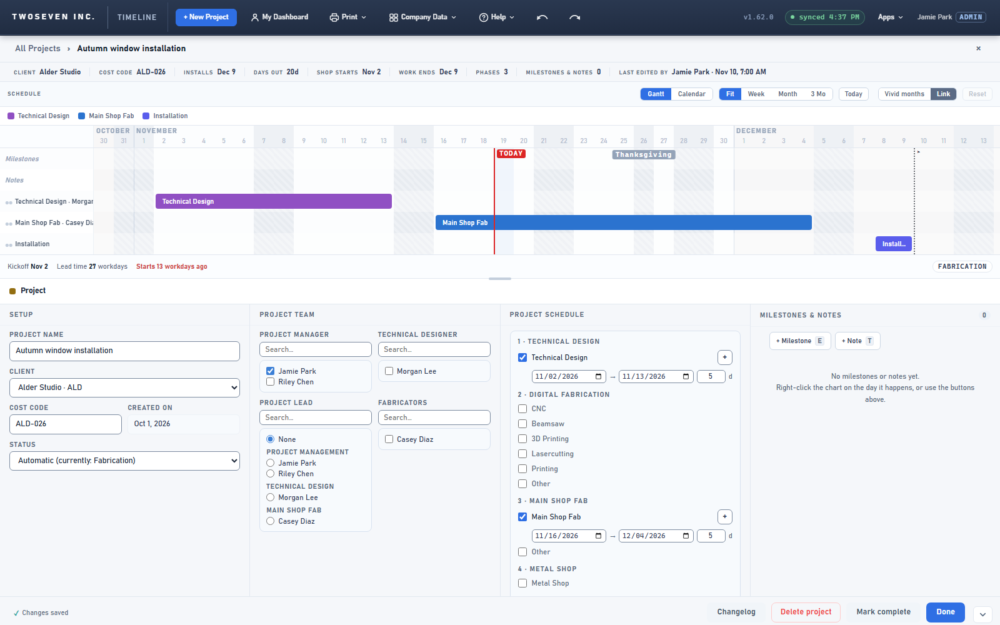
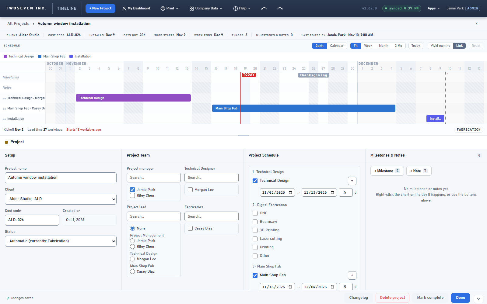
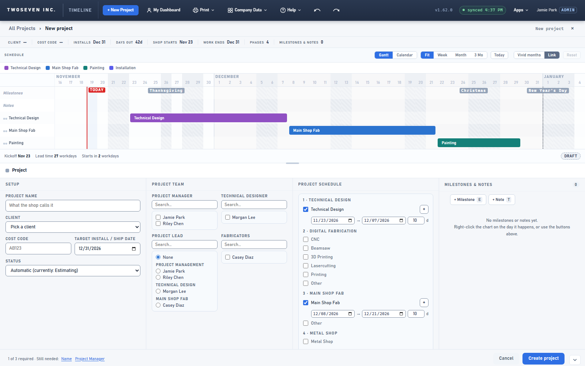
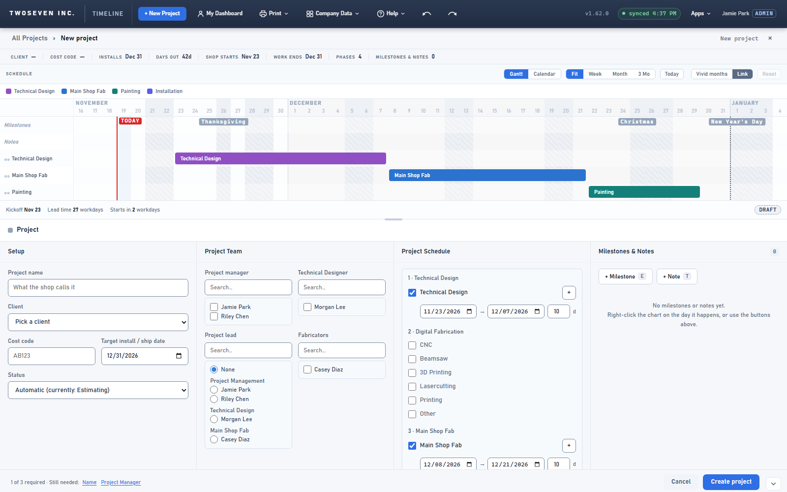
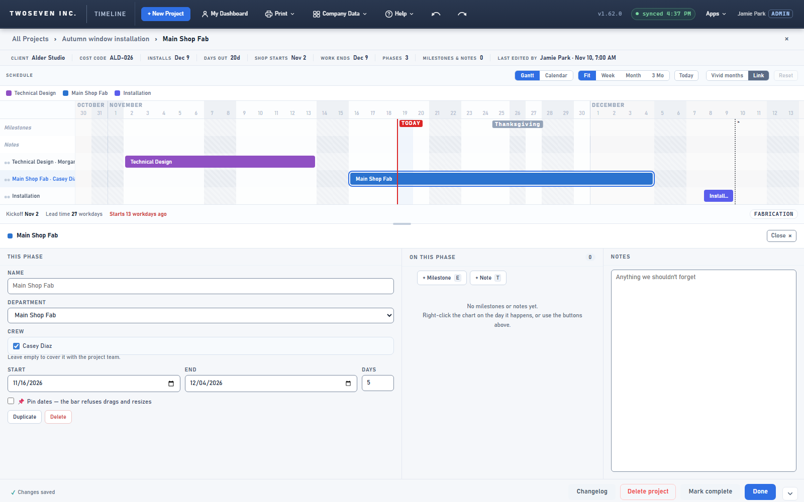

# v1.62.1 — The project inspector, restyled to the wireframes

**Date:** 2026-11-19 · **Item:** 52, step 3 (the style track) · **App:** v1.62.1 (preview)

## What changed
The editing panel under a project's chart (the "inspector": Setup, Project Team, Project
Schedule, Milestones & Notes, and a selected phase's This Phase / On This Phase / Notes) now
follows the owner's wireframes and `design/TwoSeven-Application-Style-Guide.md`:

- **Headings** read as written, in **Title Case**, 13px semibold dark text, instead of small
  spaced capitals in grey. The owner ruled out sentence case (2026-11-19): "Project Team",
  not "Project team". The two phase headings became "This Phase" and "On This Phase" to match.
- **Labels** are 12px grey text, not capitals.
- **Fields** are 36px tall with 13px text (owner: OK). The compact rows (department dates and
  day counts, milestone and note rows) are 28px.
- **Buttons** (Close, Duplicate, Delete, + Milestone, + Note) are 32px; Delete uses the
  standard danger red.
- **Focus** is a 2px blue ring 2px clear of the control. The old faint blue glow (12% opacity)
  was too weak to see.
- **Small fixes on the way:** the × on a milestone row was barely visible (1.5:1). It is now
  readable grey in a 28px box. The department + and × buttons are 28px, and checkboxes are
  16px. The milestone column's buttons line up with its heading.
- **Dialogs** (phase editor, print, meeting sheet, late-PM prompt, sign-in, tour): Tab and
  Shift+Tab stay inside the open dialog, and closing it puts focus back on what opened it.
  Timeline had no focus trapping before. One small watcher covers all six.

No data, SharePoint or sign-in changes.

## Evidence
Same fictional seed, before and after, 1600×1000:

| | Before | After |
|---|---|---|
| Saved project |  |  |
| New Project draft |  |  |
| A selected phase |  |  |

Tests: `tests/test-v1621.js` (recipes, Title Case headings on the saved page and the draft,
the focus trap); `tests/test49.js` reads "On This Phase".

## Accessibility (Design-Language §9)
- Text contrast: headings and field text use `--ts-text` and labels `--ts-muted` (≥ 4.5:1 on
  white). The milestone × moved from `#CBD6E4` to `--ts-muted`.
- Focus visible: a 2px `--ts-action` ring, offset 2px, on every control in the panel and its
  phase popover. No inspector rule turns the outline off any more.
- Hit targets: buttons 32px, compact controls 28px (≥ 24px).
- Informational text ≥ 11px (the smallest is the 11px count chip).
- No new action, so the three-path rule is unchanged. Status is still carried by its label.

## Ceilings and what's left
- **My Dashboard's dock** shares the section markup and keeps its small-capital headings
  until it gets its own step.
- **The dialogs' own look** (headings, fields, buttons) is unchanged. Only the keyboard
  trap is new.
- The phase popover on the chart shares the field and button styles, so it changed too.
- At the default panel height (280px), the taller fields show about one field less in
  Setup before the column scrolls.
