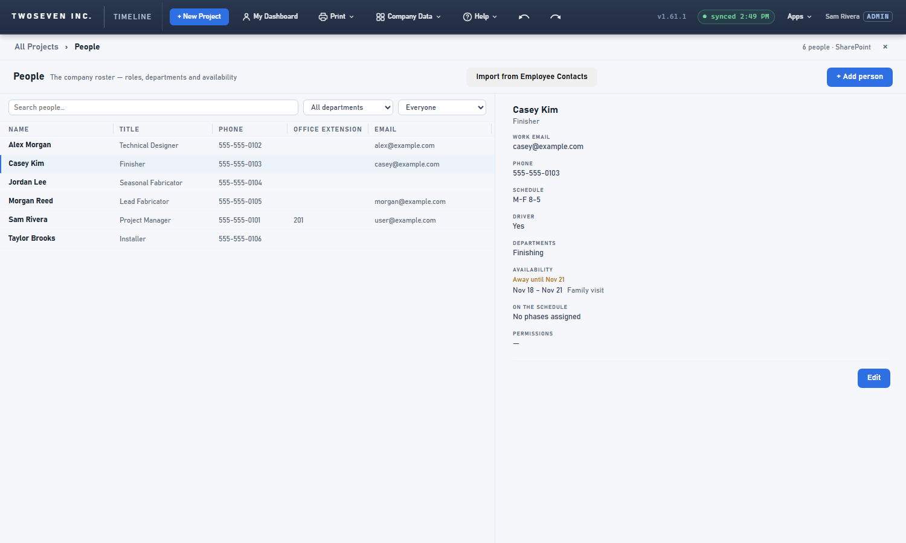
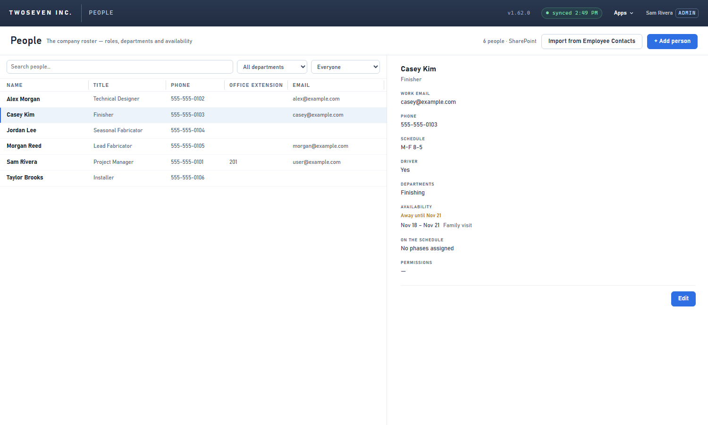
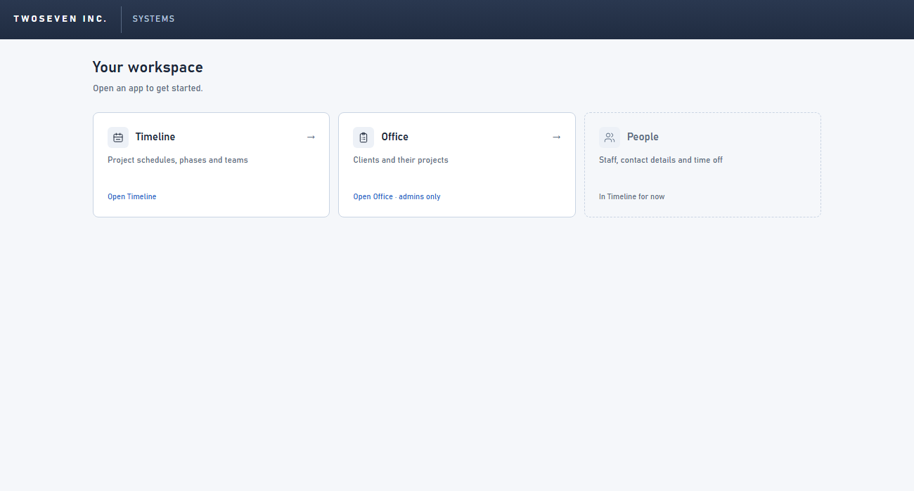
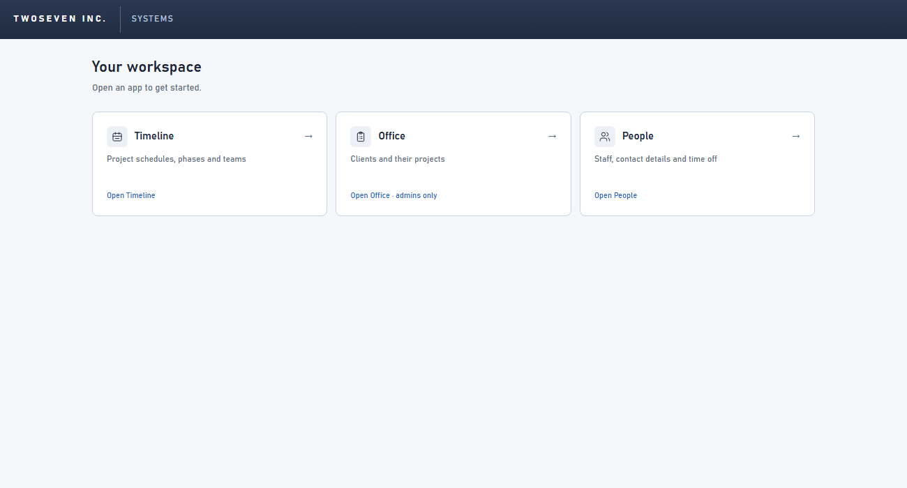
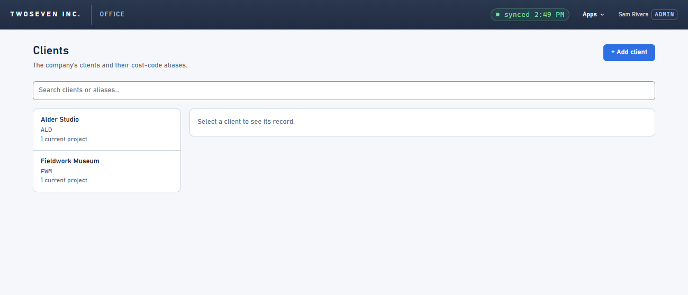
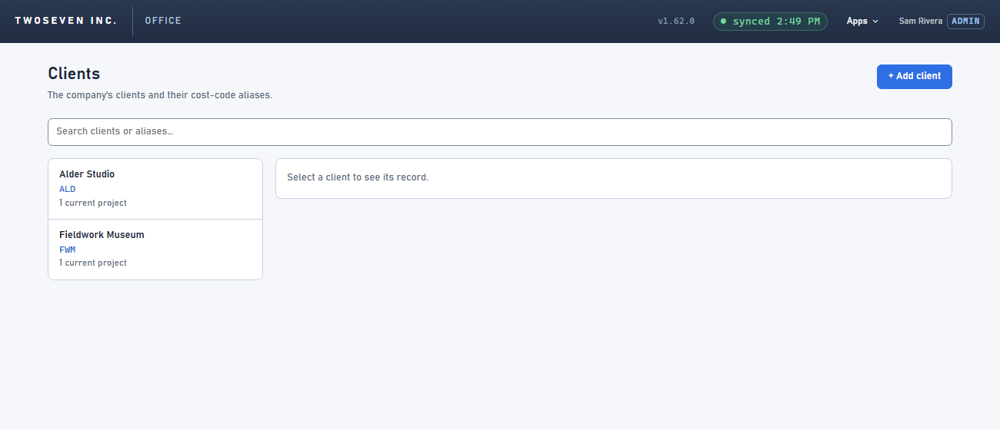

# People, its own app — v1.62.0

**Date:** 2026-11-19 · **Version:** v1.62.0 · **Items:** 87 (the People app) and 101 (the
version in the headers) · **PR:** see `docs/TODO-Done.md`, items 87 and 101

## What changed

The third Systems product. Timeline's People page moved out into its own app at `people/`,
the way Clients (now Office) did in v1.58.0. The owner approved the wording and picked the
merge option on 2026-11-19: "Wording OK, go with option (a)".

- **The People app** (`/people/`): the shared header (TWOSEVEN INC., PEOPLE, the version,
  the sync pill, Apps, who's signed in), then the page exactly as it was in Timeline: the
  heading and its line, the nine-column directory with its search and filters, ↑↓, the
  resizable columns and their Reset widths menu, the record and its editor, time off, the
  Employee Contacts import, the phone tidy, the Team-membership name suggestions and
  Merge duplicate. No left rail while the directory is the only section.
- **Everyone signed in reads it; admins edit it**, as before (Office is admins only).
- **Merging two people still moves Timeline's records** (option a). Once the roster save
  lands, the app rewrites the duplicate's names on projects (the four role fields), phases
  (the crew) and to-dos (the assignees), and links them to the kept person by ID. It sends
  only those fields and `refs`, one record at a time, so an edit someone makes to anything
  else on the record at the same moment is never overwritten. A failed roster save holds the
  renames until the sync pill's retry. The ruling sits under the ownership rule in
  `docs/Decisions.md`: changing names creates and deletes nothing in Timeline's lists.
- **In Timeline:** Company Data lists only the Changelog; an old `#/people` link goes on to
  the People app; the empty name lists say "add them in People". Pickers, people lanes and
  availability still read Staff, and a person's own notes and saved views are still saved
  from Timeline. The page's code (about 700 lines) and its styles left with it.
- **The Systems page and the Apps menu** open People ("Open People").
- **Office and People show the version** in the header, before the sync pill, as Timeline
  does (item 101, owner, the same day).
- **Shared code:** the Staff record's reader and writer, the phone format, holidays, the
  department groups and the people departments moved into `common/common.js`.

No SharePoint list or column changed. The owner added the `/people/` and `/preview/people/`
sign-in addresses in Entra on 2026-11-19, before the merge (`docs/SETUP.md`). The development deploy
workflow lists `people/`; `main`'s copy waits on the owner's go (item 100).

## Screenshots

| | |
|---|---|
| People in Timeline, before |  |
| The People app, after |  |
| Systems page, before |  |
| Systems page, after |  |
| Office's header, before |  |
| Office's header, after (the version) |  |

All fictional data.

## Known limits and follow-ups

- **A merge reaches an open Timeline tab on its next refresh** (the 90-second poll), not at
  once. Someone editing one of the renamed records in that window, and saving it, writes the
  old name back to that one record; a second merge or a rename on People fixes it.
- **`main`'s deploy list** lacks `office/` and `people/` (item 100): a hotfix pushed to
  `main` before the launch takes `/preview/office/` and `/preview/people/` offline until the
  next push to `development`.
- **No Help menu in Office or People yet** (release notes, "Report a bug or idea" and the
  tour are in Timeline's Help), as noted for Clients in v1.58.0.
- The merge's field list mirrors Timeline's `mapRecNames`; a new people field on projects,
  phases or to-dos has to be added in both (`ponytail:` note in `people/index.html`).

## Checks

- `tests/test-v1620.js`: the page and its wording, the directory, the record (phases counted
  from Timeline's data, a phase with no crew following the project's role), editing, the
  merge (the count, the roster first, name fields and refs only, the free-text department
  left alone, a failed save holding the renames), access, what it writes, Timeline's side,
  the shared rules, the Systems page and the Apps menu, and the version in the header.
- The People-page checks in 24 older suites now boot the People app beside Timeline
  (`bootPeople` in `tests/harness.js`); their Timeline checks are unchanged.
- `/code-review` (high) found 8 items, and 7 were fixed:
  - The merge's renames re-read each record when they write, so a retry never writes a stale
    value over someone's edit. They also read the three lists in parallel.
  - With the projects unreadable, a record said "No phases assigned". Now it says it couldn't
    read the projects, and so does Remove person.
  - A repaint during an import re-enabled its button. A row never created on the list was
    DELETEd as `items/undefined`.
  - Timeline's leftover merge continuation was removed, and the Systems page sends an old
    `#/people` link straight to People.

  Left as is: with the Staff list unreachable, People shows an error page rather than
  Timeline's browser-only copy, because People owns the list and edits to a local copy
  never reached anyone.
