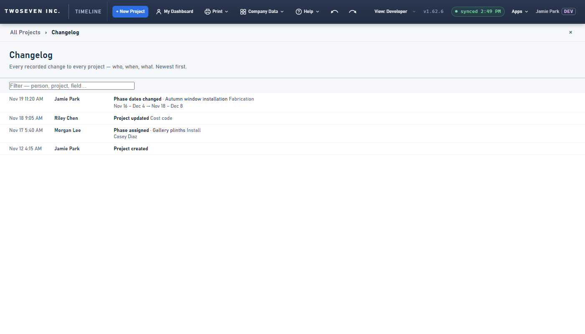
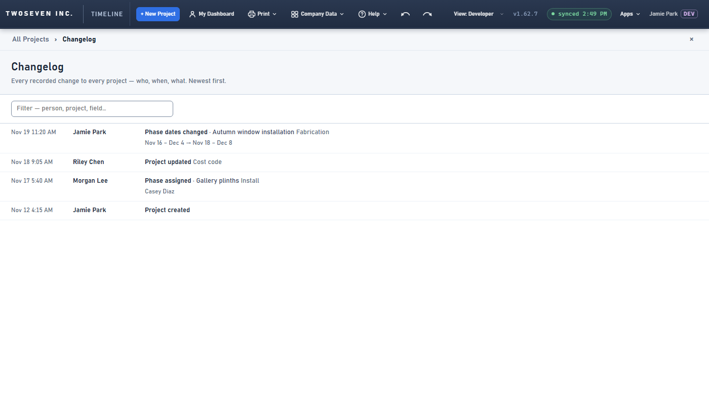
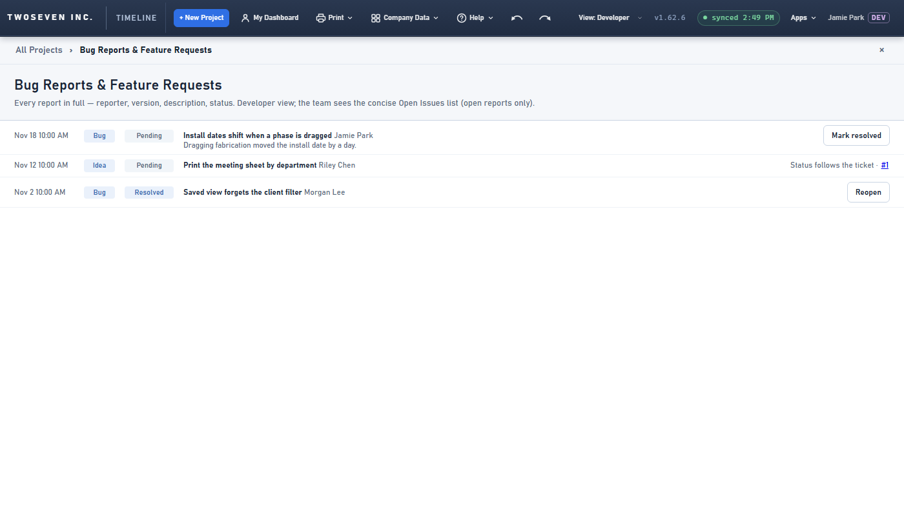
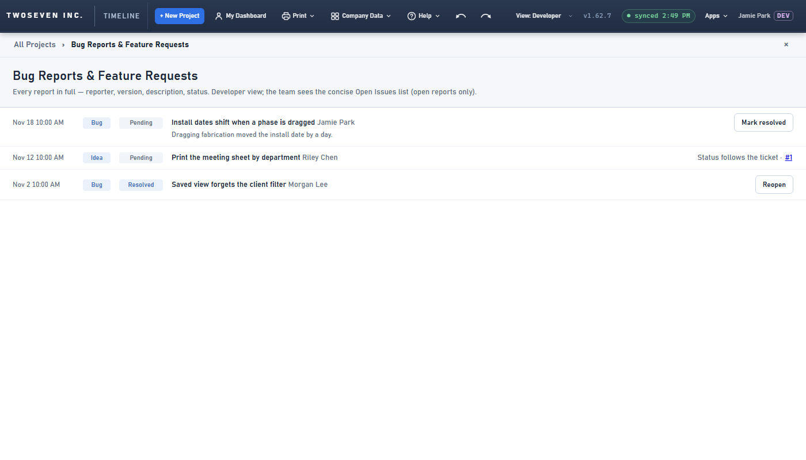
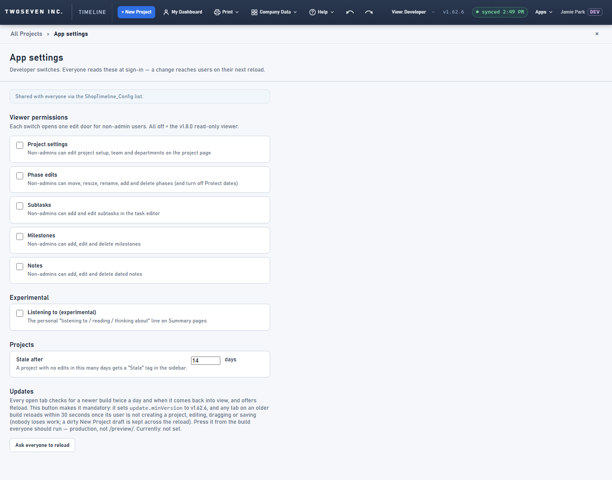
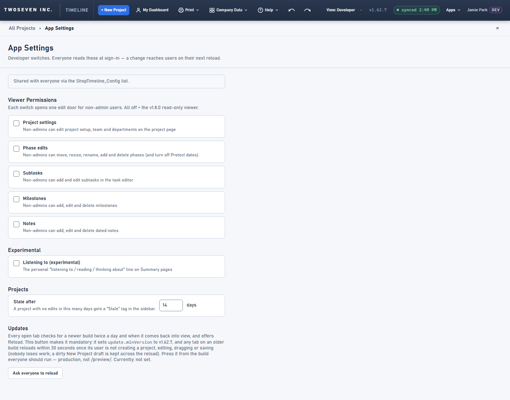

# v1.62.7 — the developer pages, restyled to the wireframes

**Date:** 2026-11-20 · **Item:** 52, step 5 (the style track: business pages) · **App:** v1.62.7 (preview)

## What changed
The owner approved the mock and its wording on 2026-11-20 ("Yes, with wording").

- **Changelog** (Company Data ▸ Changelog, admins): the filter was a bare browser box. It is now
  a proper field with the app's edge and corner. The rows are 13px, like Open Issues', with the
  person's name in the text colour and the folded detail in 12px grey.
- **Bug Reports & Feature Requests** (developers): the same 13px rows. The tags, the Mark
  resolved / Reopen buttons and the ticket link are unchanged.
- **App Settings** (developers): the note about the Config list uses the app's grey and edge,
  not a blue tint (its amber warning, when the list is missing, stays). The "Stale after"
  number box is a proper field, lined up with its "days" label.
- **Wording:** the page and its breadcrumb read "App Settings", and the first section reads
  "Viewer Permissions" (the owner's Title Case rule for headings). The Help menu row stays
  "App settings", like the other menu rows.

The project page's own changelog panel is not touched; it comes with the project page.

## Evidence
Same fictional seed, before and after, signed in as a developer:

| | Before | After |
|---|---|---|
| Changelog |  |  |
| Bug Reports |  |  |
| App Settings |  |  |

Tests: `tests/test-v1627.js` covers the rows, the filter, the Config note and its warning,
the "Stale after" field, and the App Settings wording with the menu row unchanged.
`test-v1490` now expects "App Settings".

## Accessibility (Design-Language §9)
- Text contrast: rows use `--ts-text`; dates, details and the Config note use `--ts-muted`.
  All are ≥ 4.5:1.
- The two fields have a `--ts-control-line` edge (3:1) and the global focus ring.
- Informational text ≥ 11px: the smallest text is the 11px tags, as before.

## Next
The project page, the last surface of step 5.
