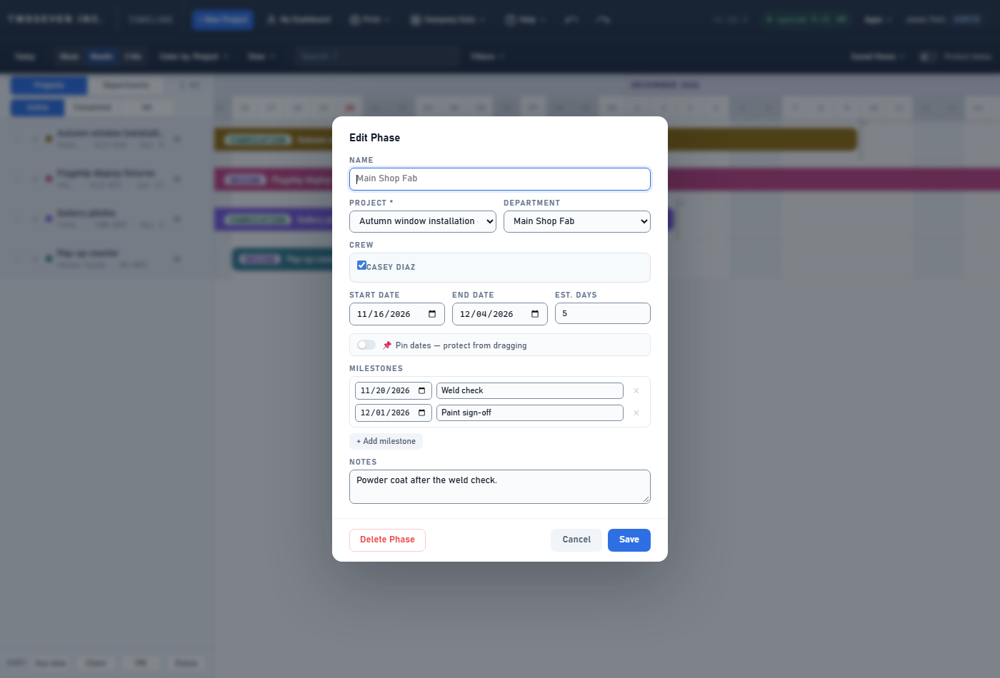
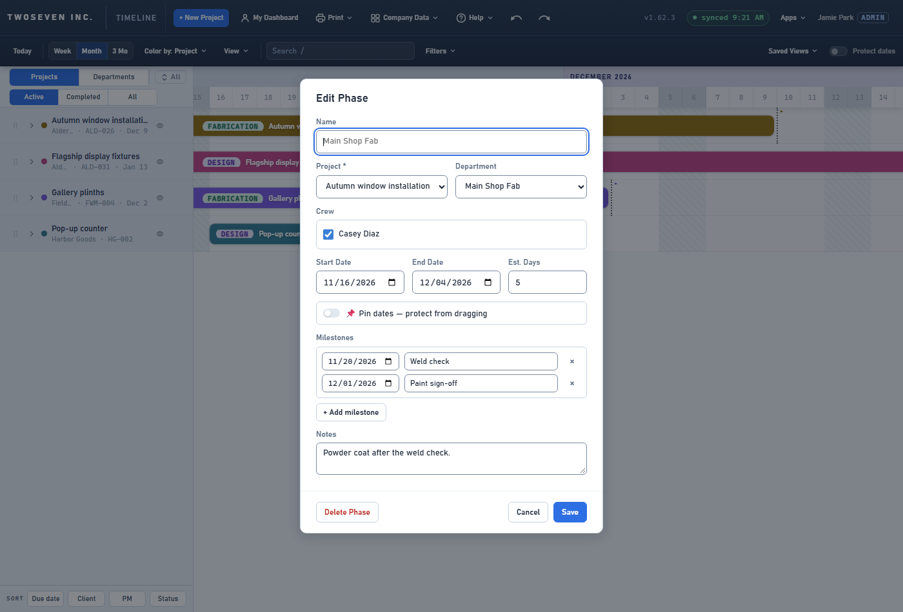
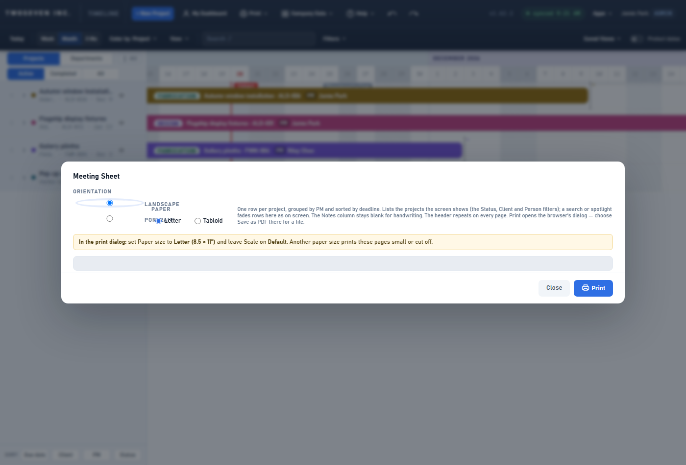
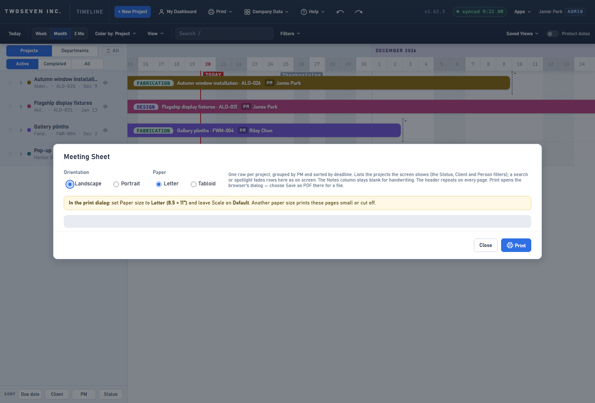
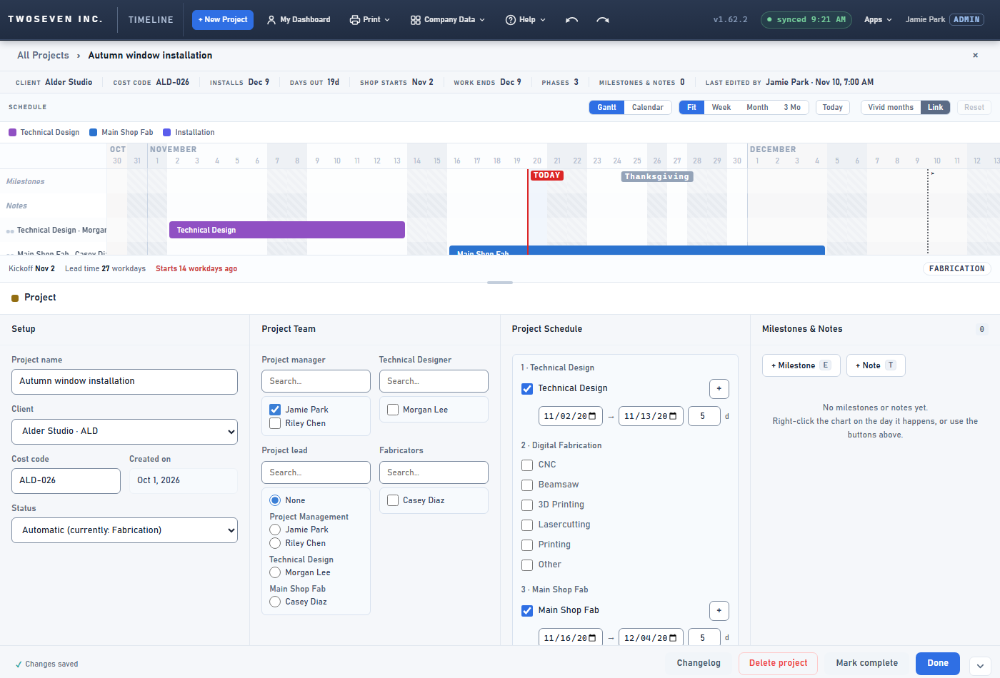
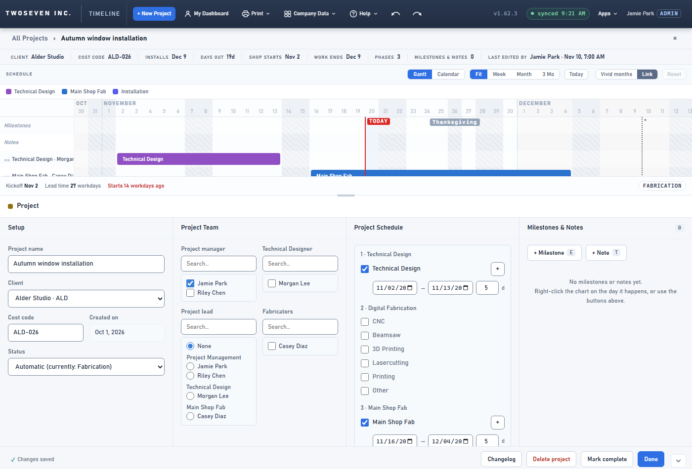
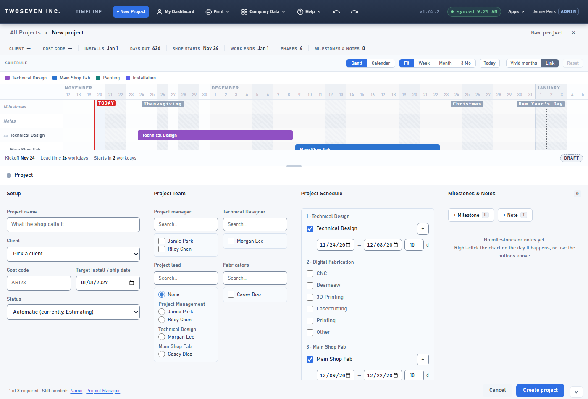
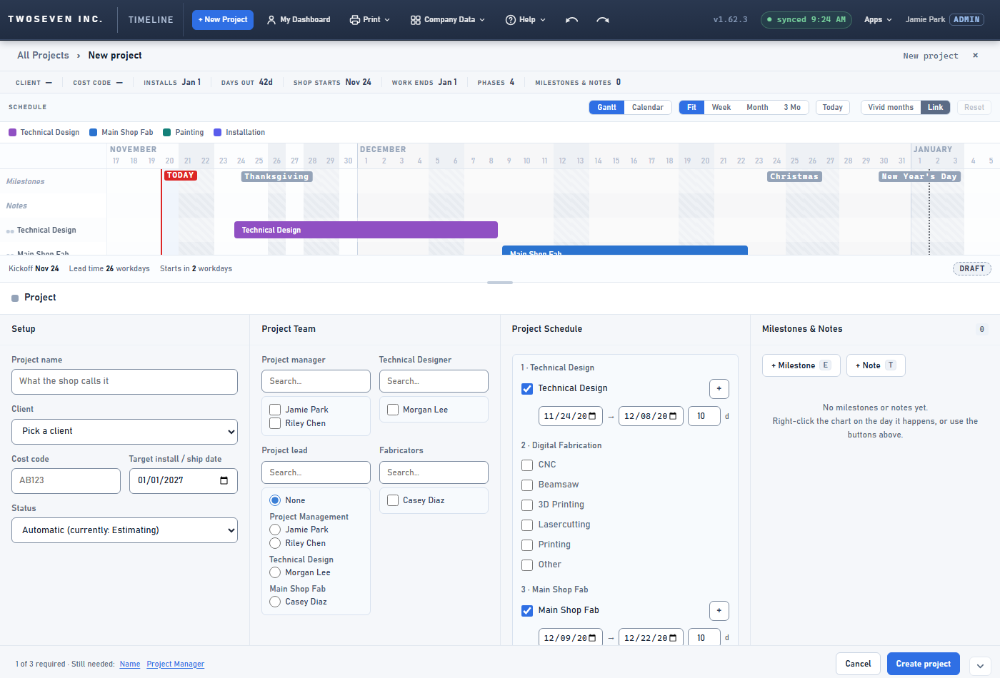

# v1.62.3 — The pop-up windows, restyled to match the project page

**Date:** 2026-11-20 · **Item:** 52, step 3 (the style track), third surface · **App:** v1.62.3 (preview)

## What changed
Timeline's pop-up windows (Edit Phase, Print Preview, Meeting Sheet, the late-project
prompt, sign-in expired, and the demo slides) now look like the wireframes' dialog and match
the project inspector from v1.62.1. The owner OK'd the mock on 2026-11-20.

- **The window** has 10px corners, a thin edge, and the lighter shadow menus use. The blur
  behind it is gone; the style guide lets that go, and the dark backdrop stays.
- **Titles** are 17px semibold. No wording changed.
- **Field labels** are plain 12px text instead of small capitals. **Fields** are 36px, white,
  with 6px corners, and show the 2px blue focus ring instead of a faint glow.
- **Buttons** are 32px. Cancel, Close, Later and the other secondary buttons are white with an
  edge, Save and Print stay blue, and Delete is red text. These are the app's shared buttons,
  so the project page's footer (Changelog, Delete project, Mark complete, Done; Cancel and
  Create project on a draft) and the Open Issues form now match too.
- **Edit Phase:** milestone rows have 28px fields and a readable × in a 28px box, and
  "+ Add milestone" is a small secondary button.
- **Two fixes along the way:**
  - Edit Phase's crew list showed names in capitals, with the tick box crowding them.
    The field-label rule outranked the crew list's own, so the crew list's rule now wins.
  - Meeting Sheet's Landscape and Portrait stacked out of line. The field lacked the class
    its Paper neighbour has.

## Evidence
Same fictional seed, before and after, 1400×950:

| | Before | After |
|---|---|---|
| Edit Phase |  |  |
| Meeting Sheet |  |  |
| Saved project (footer) |  |  |
| New Project draft (footer) |  |  |

Tests: `tests/test-v1623.js` covers the dialog recipes, the Edit Phase title, labels and
fields as rendered, the crew list, milestone rows and Meeting Sheet's orientation.

## Accessibility (Design-Language §9)
- Text contrast: labels in `--ts-muted`, text in `--ts-text`, Delete in `--ts-danger-text`, all
  ≥ 4.5:1 (`test-contrast` green).
- Focus visible: the 2px ring offset 2px covers every dialog. Tab stays inside a dialog and
  returns to its opener (shipped in v1.62.1).
- Hit targets: buttons ≥ 32px, milestone × and crew rows ≥ 28px.
- Informational text ≥ 11px: hints went from 11px to 12px.

## Known limits
- jsdom (the test harness) settles the CSS cascade by source order, not specificity, so the
  crew-list and orientation layouts are checked in the stylesheet, not as rendered. The
  screenshots show them rendered.
- The Open Issues form is a business page (step 5). It picked up the new fields and buttons
  here because they share the classes; its own layout waits for step 5.

## What's left of step 3
The menus and popovers.
