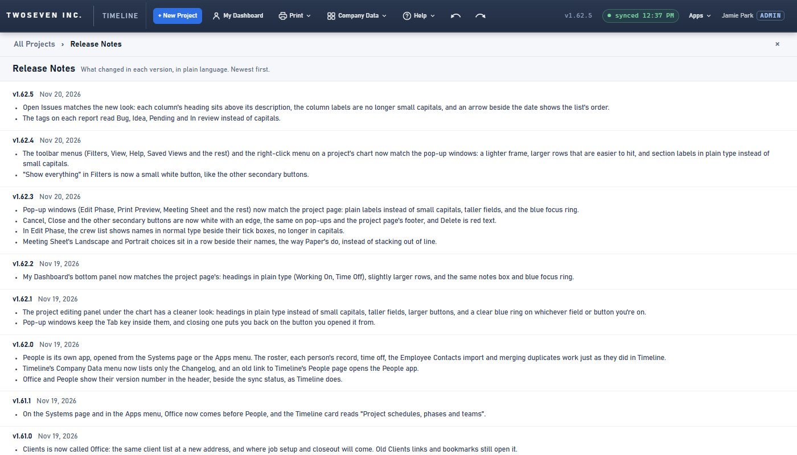
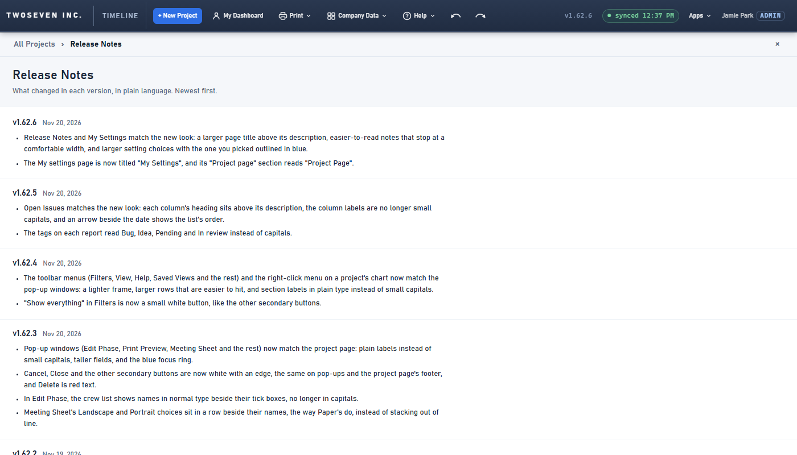
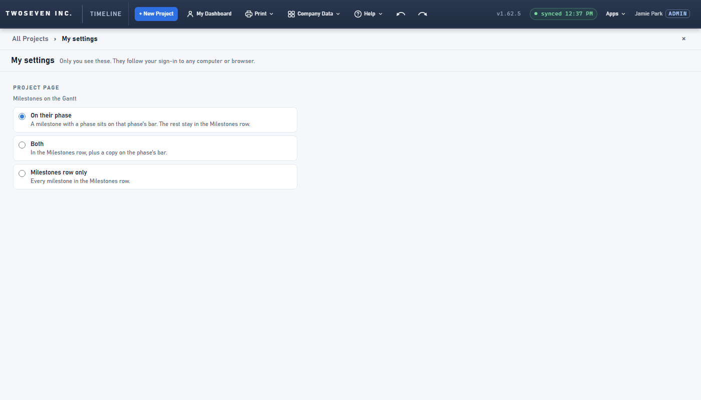
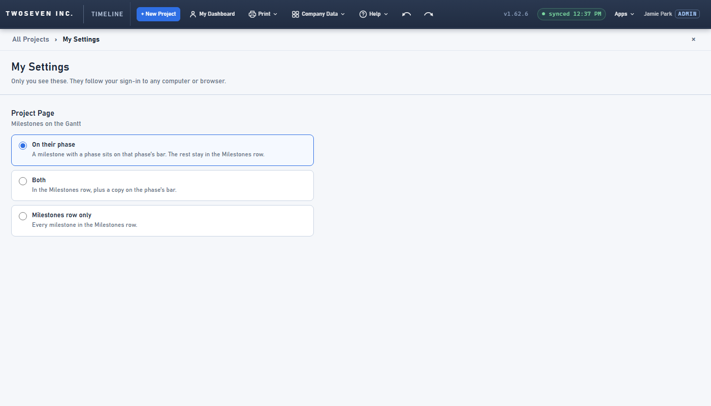

# v1.62.6 — Release Notes and My Settings, restyled to the wireframes

**Date:** 2026-11-20 · **Item:** 52, step 5 (the style track: business pages) · **App:** v1.62.6 (preview)

## What changed
The owner approved the mock and its wording on 2026-11-20 ("Yes, with wording").

- **Page title:** every full-width Help and Company Data page (Release Notes, My Settings,
  and the developer Changelog and App settings) now has the wireframes' page title. It's 22px,
  with its one-line description underneath instead of beside it.
- **Release Notes:** each version number is larger (15px). The notes are 13px with more space
  between lines, and they stop at a comfortable reading width instead of running across a
  wide screen.
- **My Settings:** the section heading is a plain 15px heading instead of small capitals. The
  choices are slightly larger, and the one you picked has a blue edge and a pale blue fill.
  The radio button still marks it, so colour isn't the only cue. The developer App settings
  page uses the same rows.
- **Wording:** the page and its breadcrumb read "My Settings", and the section reads "Project
  Page" (the owner's Title Case rule for headings). The Help menu row stays "My settings",
  like the other menu rows.

## Evidence
Same fictional seed, before and after, 1400×800:

| | Before | After |
|---|---|---|
| Release Notes |  |  |
| My Settings |  |  |

App settings is developer-only, and the preview stub isn't signed in as a developer, so it
has no screenshot. It uses the same recipe as My Settings.

Tests: `tests/test-v1626.js` covers the page title, Release Notes, My Settings' wording and
recipe, and the unchanged menu row. `test-v1500` now expects the new wording.

## Accessibility (Design-Language §9)
- Text contrast: titles, notes and choices use `--ts-text`; descriptions use `--ts-muted`.
  All are ≥ 4.5:1.
- The chosen setting is marked by its radio button as well as the blue edge.
- Informational text ≥ 11px: the smallest text is 12px (dates, choice descriptions).

## Next
The developer pages (Changelog, Reports, App settings) get their own pass. App settings'
rows and every page title already match. The project page comes after that.
