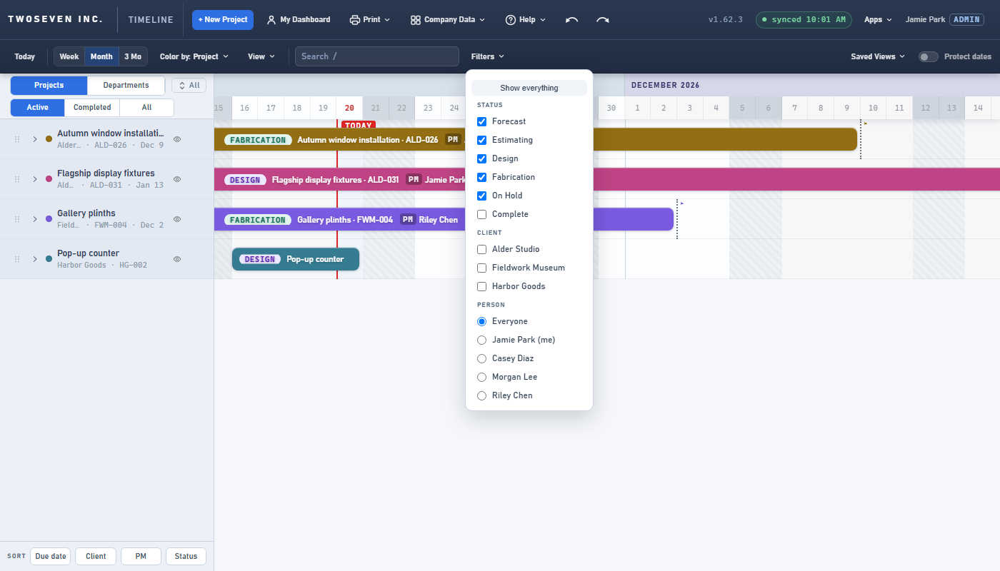
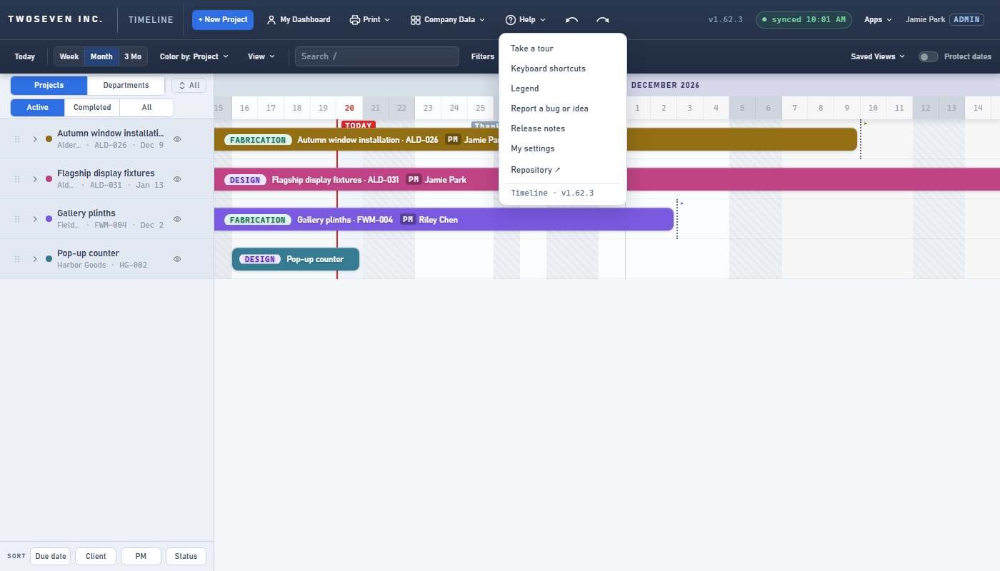
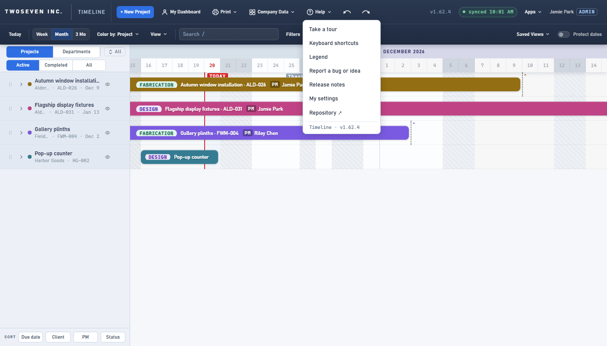
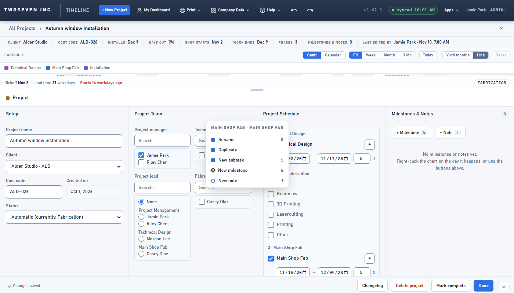
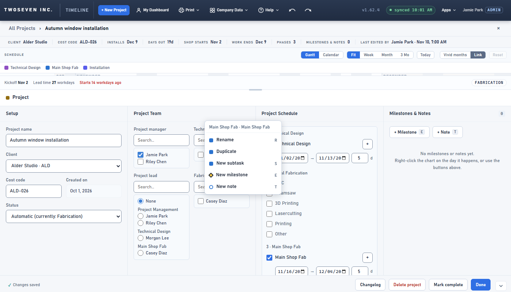
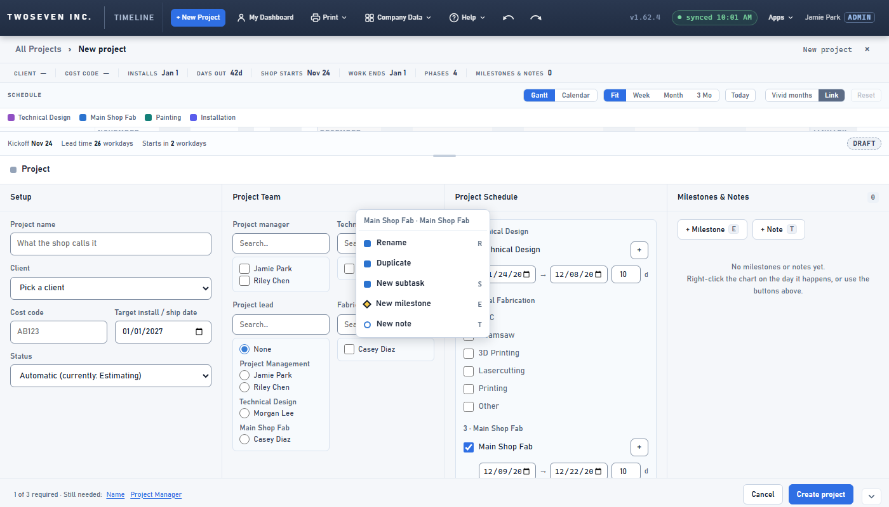

# v1.62.4 — The menus, restyled to match the pop-up windows

**Date:** 2026-11-20 · **Item:** 52, step 3 (the style track), last surface · **App:** v1.62.4 (preview)

## What changed
Timeline's menus and small popovers now share one look with the pop-up windows from v1.62.3.
The owner approved the mock on 2026-11-20 and chose the larger rows.

- **One frame:** Every toolbar menu (Filters, View, Help, Print, Saved Views, Apps and the
  rest), the right-click menu on a project's chart, the edit-in-place popover and My
  Dashboard's thought popover share one frame: a thin edge, 8px corners and the same light
  shadow. 8px is the corner on the wireframes' app switcher.
- **Rows:** 13px text in the normal ink, at least 32px tall, with 16px tick boxes. The right-click
  menu's shortcut letters are monospaced.
- **Section labels:** "Status", "Client", "Person", the right-click menu's header and the
  Legend's sections are written as they are, not in small capitals. No wording changed.
- **"Show everything"** and "Save current view…" are small white secondary buttons.
- **Keyboard focus** inside a menu is the 2px blue ring. It's drawn inside the row, because a
  menu cuts off whatever sticks out.

This finishes step 3 of the style track: the inspector (v1.62.1), My Dashboard's panel
(v1.62.2), the dialogs (v1.62.3) and the menus. Step 5, the business pages, is next.

## Evidence
Same fictional seed, before and after, 1400×800:

| | Before | After |
|---|---|---|
| Filters |  |  |
| Help |  |  |
| Right-click, saved project |  |  |
| Right-click, New Project draft |  |  |

Tests: `tests/test-v1624.js` covers the frame on all four kinds of menu, the row and label
recipes, Filters as rendered, and the right-click menu on a saved project and on the draft.

## Accessibility (Design-Language §9)
- Text contrast: rows in `--ts-text`, labels and shortcut letters in `--ts-muted`, all ≥ 4.5:1
  (`test-contrast` green).
- Focus visible: a 2px ring on every menu row. The right-click menu's name field no longer
  switches its outline off.
- Hit targets: menu rows ≥ 32px, Saved Views' small buttons ≥ 28px (up from 24px).
- Informational text ≥ 11px: the section labels went from 9px to 11px.

## Known limits
The Apps menu takes the new frame, but its rows come from the shared `common/common.css`
(`.ts-apps-item`), which Office and People use too. They stay as they are so the menu reads
the same in every product. Changing them belongs with the shared core, not this Timeline pass.

The Filters menu is taller with 32px rows. With many clients it scrolls sooner; it already
stops at 70% of the window. The owner chose the larger rows over 28px ones (2026-11-20).
