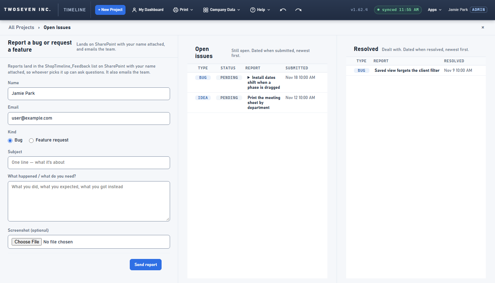
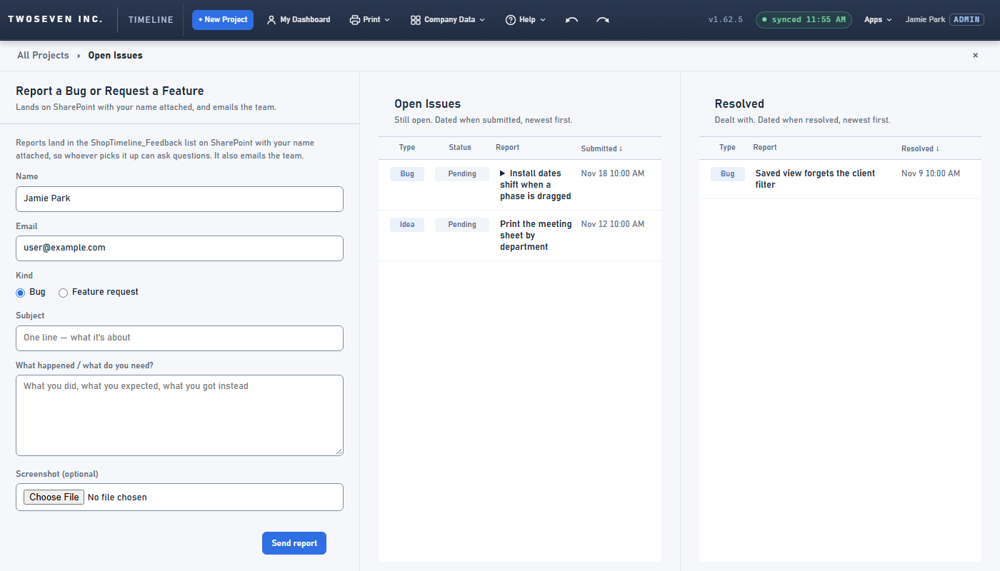
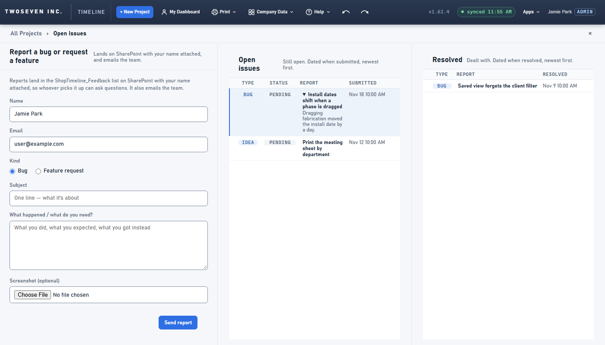
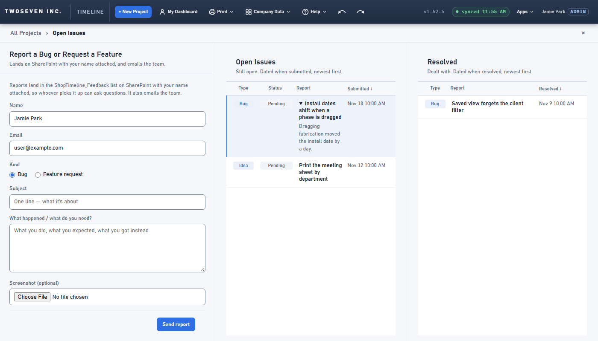

# v1.62.5 — Open Issues, restyled to the wireframes

**Date:** 2026-11-20 · **Item:** 52, step 5 (the style track: business pages), first page · **App:** v1.62.5 (preview)

## What changed
Open Issues is the first business page on the new look. The owner approved the mock and its
wording on 2026-11-20 ("Yes, with wording").

- **Column headings:** each of the three columns has its heading above its one-line
  description instead of beside it, so the headings no longer wrap. They're in Title Case:
  "Report a Bug or Request a Feature", "Open Issues", "Resolved".
- **Column labels:** Type, Status, Report, Submitted and Resolved are the wireframes' soft
  table header: plain 11px type on a pale band, not small capitals in the code font. The date
  label has a ↓ to show the list is newest first. The column's line already says it in words,
  so screen readers skip the arrow.
- **Rows:** 13px text with more room. The folded report text is 12px in the muted ink.
- **Tags:** Bug, Idea, Pending and In review are written as words, not capitals, in the
  page's own type with the chip corner. The developer Reports page shows the same tags.

Nothing about how reports are filed, listed or linked changed. The reply email's link
(`#/issues/<id>`) still opens and marks its report.

## Evidence
Same fictional seed, before and after, 1400×800:

| | Before | After |
|---|---|---|
| Open Issues |  |  |
| From a reply email's link |  |  |

Tests: `tests/test-v1625.js` covers the headings, the label row, the tags and the reply link.
`test-v1340`, `test-v1390` and `test-v1401` now expect the new wording.

## Accessibility (Design-Language §9)
- Text contrast: rows in `--ts-text`, labels, dates and folded text in `--ts-muted`, all ≥ 4.5:1.
- Status still readable without colour: each tag is a word.
- Informational text ≥ 11px: the column labels and tags are 11px (the labels were 11px
  capitals before).
- The ↓ is decorative (`aria-hidden`); the order is stated in each column's line.

## Next
Step 5 continues, each with a mock first: Release Notes and My settings, then the developer
pages, then the project page.
