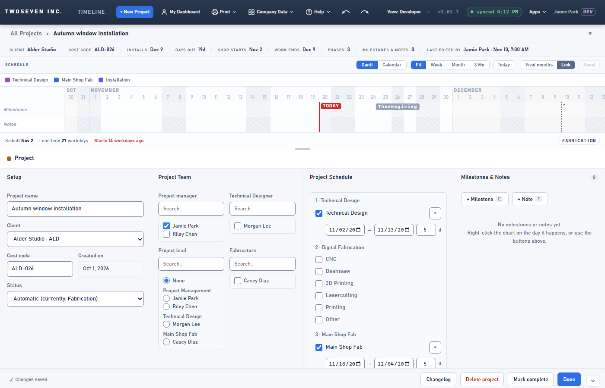
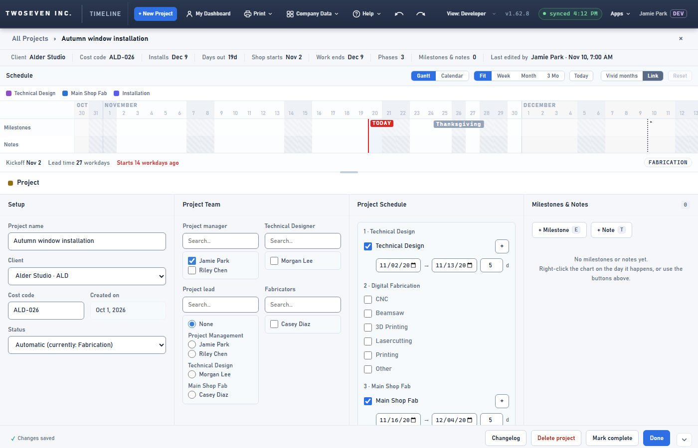
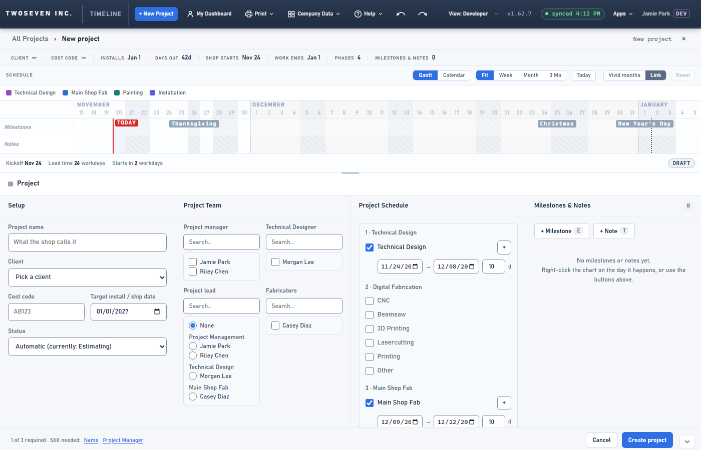
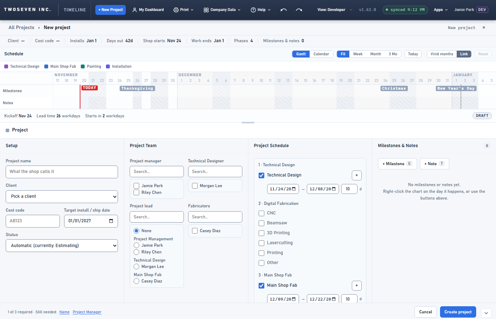

# v1.62.8 — the project page, restyled to the wireframes

**Date:** 2026-11-20 · **Item:** 52, step 5 (the style track: business pages) · **App:** v1.62.8 (preview)

## What changed
The owner approved the mock on 2026-11-20 ("Yes, build it").

- **Summary line** (under the breadcrumb): the labels read as written (Client, Cost code,
  Installs, Days out, Shop starts…) in 12px grey instead of tiny capitals, and the values are
  13px in the text colour.
- **Schedule:** the chart's heading reads "Schedule" in plain 13px type, not small capitals.
- **Milestones and Notes:** the chart's two extra rows are labelled upright, no longer italic.
- **Kickoff line** (under the chart): 12px, with its numbers in the text colour.

No wording changed: the labels were already written this way and only the styling showed
them in capitals. The page keeps its height, so the chart doesn't lose a row. The editing
panel under the chart was restyled in v1.62.1.

## Evidence
Same fictional seed, before and after, 1400×900:

| | Before | After |
|---|---|---|
| A saved project |  |  |
| A new project |  |  |

Tests: `tests/test-v1628.js` checks the recipes, then the labels, the Schedule heading and the
Kickoff line on both a saved project and the new-project draft.

## Accessibility (Design-Language §9)
- Text contrast: values use `--ts-text`, labels and the Kickoff line `--ts-muted`; both are
  ≥ 4.5:1. The Milestones and Notes labels move from a pale canvas grey to `--ts-muted`.
- Warnings (Overdue by, Work runs past the install date) keep their red.
- Informational text ≥ 11px: the smallest new text is 12px.

## Left in place
The chart's own capitals (month names, the status tag such as FABRICATION or DRAFT, the bars'
phase tags) match the bars on the main timeline, so they would change together, as a step of
their own. This finishes step 5's agreed order (Open Issues, Release Notes and My Settings,
the developer pages, the project page).
